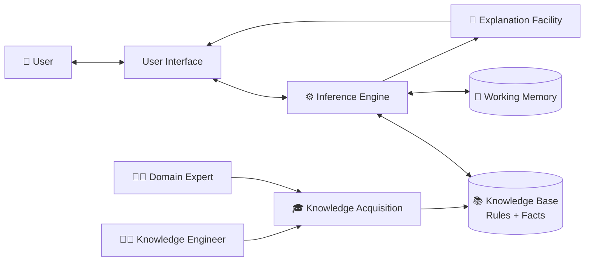
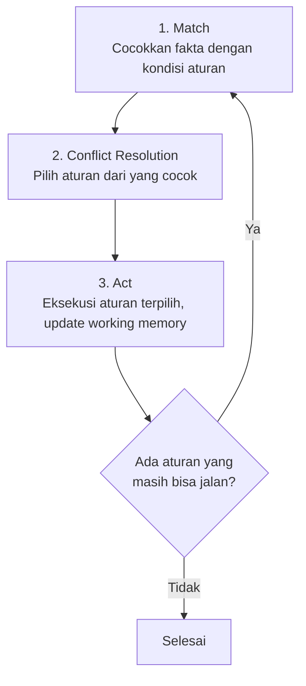
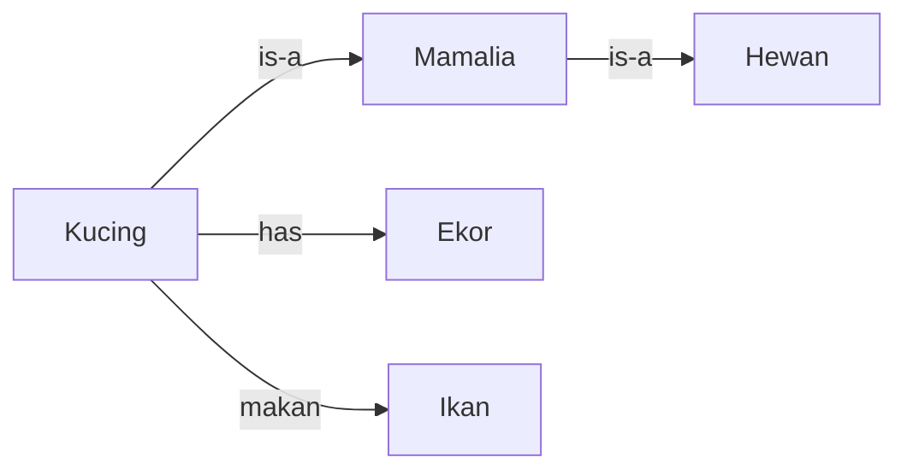
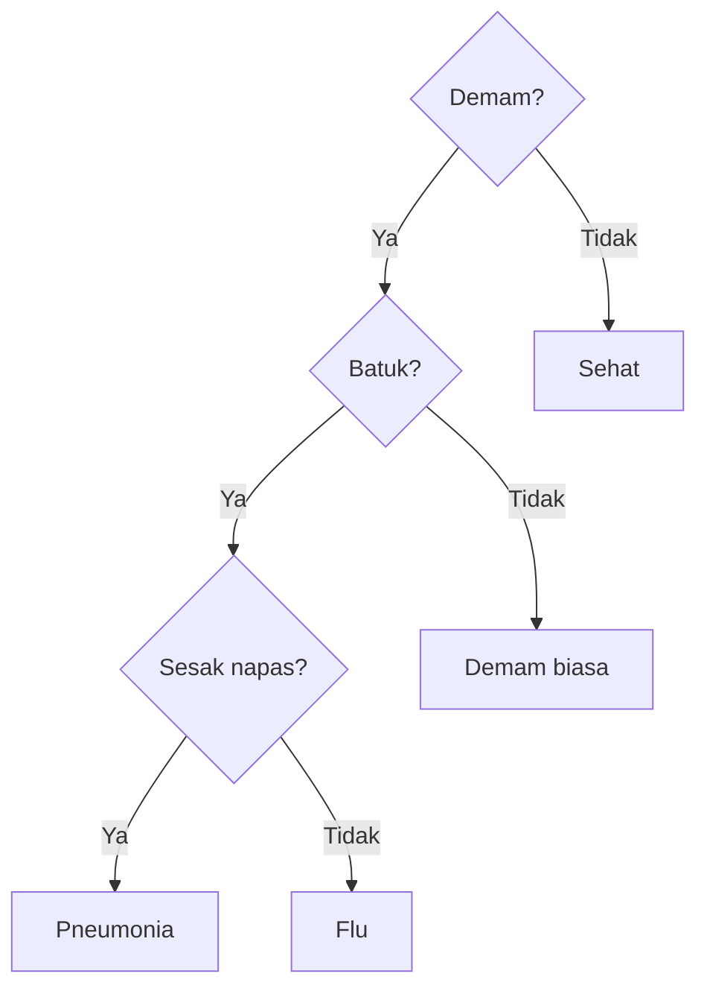
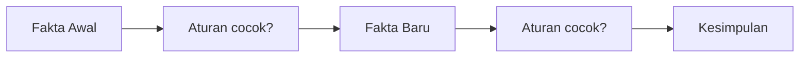
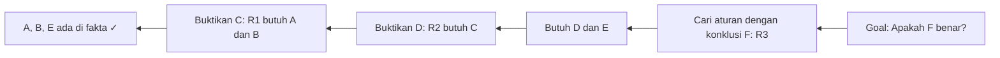
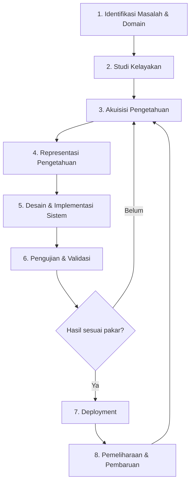

#  Expert System (Sistem Pakar) pada Kecerdasan Buatan

> Panduan lengkap tentang Expert System: konsep, arsitektur, cara kerja, representasi pengetahuan, mesin inferensi, penanganan ketidakpastian, hingga implementasi kode dengan Python.

---

## Daftar Isi

1. [Pendahuluan](#1-pendahuluan)
2. [Sejarah Singkat](#2-sejarah-singkat)
3. [Karakteristik Expert System](#3-karakteristik-expert-system)
4. [Arsitektur dan Komponen](#4-arsitektur-dan-komponen)
5. [Representasi Pengetahuan](#5-representasi-pengetahuan)
6. [Mesin Inferensi (Inference Engine)](#6-mesin-inferensi-inference-engine)
7. [Penanganan Ketidakpastian](#7-penanganan-ketidakpastian-uncertainty)
8. [Jenis-Jenis Expert System](#8-jenis-jenis-expert-system)
9. [Tahapan Pengembangan](#9-tahapan-pengembangan-expert-system)
10. [Cara Kerja Step-by-Step (Studi Kasus)](#10-cara-kerja-step-by-step-studi-kasus)
11. [Implementasi dengan Python](#11-implementasi-dengan-python)
12. [Tools dan Framework](#12-tools-dan-framework)
13. [Contoh Expert System Terkenal](#13-contoh-expert-system-terkenal)
14. [Area Aplikasi](#14-area-aplikasi)
15. [Kelebihan dan Kekurangan](#15-kelebihan-dan-kekurangan)
16. [Expert System vs Machine Learning](#16-expert-system-vs-machine-learning)
17. [Tantangan dan Tren Masa Depan](#17-tantangan-dan-tren-masa-depan)
18. [Glosarium](#18-glosarium)
19. [Referensi](#19-referensi)

---

## 1. Pendahuluan

**Expert System (Sistem Pakar)** adalah cabang dari Kecerdasan Buatan (*Artificial Intelligence*) yang meniru kemampuan **pengambilan keputusan seorang pakar manusia** pada bidang tertentu. Sistem ini menyimpan pengetahuan pakar dalam bentuk **aturan (rules)** dan **fakta (facts)**, lalu menggunakan **penalaran logis** untuk menarik kesimpulan, memberi diagnosis, atau merekomendasikan solusi.

Contoh sederhana: seorang dokter mendiagnosis penyakit berdasarkan gejala. Expert system dapat menyimpan aturan seperti:

```
JIKA demam DAN batuk DAN sesak napas
MAKA kemungkinan penyakit = pneumonia
```

Lalu sistem akan menanyakan gejala kepada pengguna, mencocokkannya dengan aturan, dan memberikan kesimpulan beserta alasannya.

### Mengapa Expert System Dibutuhkan?

| Masalah | Solusi Expert System |
|---|---|
| Pakar jumlahnya terbatas dan mahal | Pengetahuan pakar bisa digandakan dan diakses banyak orang |
| Pakar bisa pensiun atau meninggalkan organisasi | Pengetahuan terdokumentasi dan tidak hilang |
| Keputusan manusia bisa dipengaruhi emosi dan kelelahan | Konsisten dan tidak lelah |
| Butuh akses 24/7 | Sistem selalu tersedia |
| Sulit menjelaskan alasan keputusan | Ada fasilitas penjelasan (*explanation facility*) |

---

## 2. Sejarah Singkat

| Tahun | Peristiwa |
|---|---|
| 1956 | Konferensi Dartmouth, lahirnya AI sebagai bidang ilmu |
| 1965 | **DENDRAL** dimulai di Stanford (Feigenbaum, Lederberg), sistem pakar pertama untuk analisis struktur molekul kimia |
| 1972-1976 | **MYCIN** dikembangkan di Stanford untuk diagnosis infeksi bakteri dan rekomendasi antibiotik |
| 1978 | **XCON/R1** dikembangkan di CMU untuk Digital Equipment Corporation (DEC), mengonfigurasi sistem komputer VAX |
| 1980-an | *Boom* sistem pakar: industri berinvestasi besar, muncul *shell* seperti **CLIPS**, **OPS5** |
| Akhir 1980-an | **AI Winter**: ekspektasi terlalu tinggi, biaya pemeliharaan besar, sistem sulit di-*scale* |
| 1990-an - sekarang | Sistem pakar terintegrasi ke dalam **Business Rule Management System (BRMS)**, sistem pendukung keputusan, dan dikombinasikan dengan ML |

---

## 3. Karakteristik Expert System

Sistem pakar yang baik umumnya memiliki ciri berikut:

1. **Berbasis pengetahuan (*knowledge-based*)**: kekuatan utama ada pada basis pengetahuan, bukan algoritma yang rumit.
2. **Pemisahan pengetahuan dan kontrol**: aturan (*knowledge base*) terpisah dari mesin penalaran (*inference engine*), sehingga pengetahuan bisa diubah tanpa mengubah program utama.
3. **Mampu menjelaskan (*explainable*)**: bisa menjawab "Mengapa kamu bertanya ini?" (*Why*) dan "Bagaimana kamu sampai kesimpulan ini?" (*How*).
4. **Fokus pada domain sempit**: ahli di satu bidang spesifik, bukan serba bisa.
5. **Mampu menangani ketidakpastian**: data tidak selalu pasti, sistem dapat bekerja dengan tingkat keyakinan.
6. **Bersifat heuristik**: menggunakan aturan praktis (*rules of thumb*) dari pengalaman pakar, bukan hanya algoritma pasti.
7. **Dapat diperbarui**: pengetahuan baru bisa ditambahkan secara bertahap.

---

## 4. Arsitektur dan Komponen



### 4.1 Knowledge Base (Basis Pengetahuan)

Tempat menyimpan **pengetahuan domain**: fakta dan aturan. Biasanya berbentuk aturan **IF-THEN**.

- **Fakta (*facts*)**: pernyataan yang benar, misal `pasien_demam = true`.
- **Aturan (*rules*)**: hubungan logis, misal `IF demam AND batuk THEN flu`.
- **Meta-rules**: aturan tentang cara memakai aturan lain (strategi).

### 4.2 Working Memory (Memori Kerja)

Menyimpan **fakta sementara** untuk kasus yang sedang diproses, seperti jawaban pengguna dan kesimpulan antara yang dihasilkan selama penalaran. Berbeda dengan *knowledge base* yang bersifat permanen.

### 4.3 Inference Engine (Mesin Inferensi)

**Otak dari sistem pakar.** Tugasnya mencocokkan fakta dengan aturan, memilih aturan yang akan dijalankan, lalu menarik kesimpulan. Bekerja dengan strategi seperti *forward chaining* dan *backward chaining* (dibahas di Bab 6).

Siklus kerjanya disebut **Recognize-Act Cycle**:



### 4.4 User Interface (Antarmuka Pengguna)

Media komunikasi antara pengguna dan sistem: tanya-jawab, form, web, chatbot, atau API.

### 4.5 Explanation Facility (Fasilitas Penjelasan)

Menjelaskan **alasan** sistem:

- **WHY**: "Kenapa sistem menanyakan hal ini?" (menunjukkan aturan yang sedang dievaluasi)
- **HOW**: "Bagaimana kesimpulan ini dicapai?" (menunjukkan rantai aturan yang dipakai)

Ini yang membuat sistem pakar **transparan** dan dipercaya.

### 4.6 Knowledge Acquisition (Akuisisi Pengetahuan)

Proses mengumpulkan pengetahuan dari pakar, buku, dokumen, atau data. Dilakukan oleh **knowledge engineer** melalui wawancara, observasi, analisis kasus, dan *protocol analysis*.

### 4.7 Peran Manusia dalam Sistem

| Peran | Tugas |
|---|---|
| **Domain Expert** | Sumber pengetahuan |
| **Knowledge Engineer** | Menerjemahkan pengetahuan pakar menjadi aturan |
| **System Developer** | Membangun sistem dan antarmuka |
| **End User** | Pengguna yang berkonsultasi dengan sistem |

---

## 5. Representasi Pengetahuan

Cara pengetahuan disimpan dalam komputer. Beberapa metode utama:

### 5.1 Production Rules (Aturan Produksi)

Bentuk paling populer: `IF <kondisi> THEN <aksi/kesimpulan>`

```
RULE 1: IF suhu_tubuh > 38 AND batuk = ya THEN diagnosis = flu
RULE 2: IF diagnosis = flu AND sesak_napas = ya THEN diagnosis = pneumonia
```

Kelebihan: mudah dipahami dan dimodifikasi. Kekurangan: bisa sulit dikelola jika aturan sangat banyak.

### 5.2 Semantic Network (Jaringan Semantik)

Graf berisi **node** (konsep) dan **edge** (relasi).



### 5.3 Frame

Struktur data berisi **slot** (atribut) dan nilai, mendukung pewarisan (*inheritance*).

```
Frame: Pasien
  Slot nama     : (string)
  Slot umur     : (integer)
  Slot suhu     : (float)
  Slot gejala   : (list)

Frame: PasienAnak  (is-a Pasien)
  Slot umur     : < 12
  Slot dosis    : berdasarkan berat badan
```

### 5.4 Logika Predikat (First-Order Logic)

```
∀x (Manusia(x) → Fana(x))
Manusia(Socrates)
∴ Fana(Socrates)
```

Digunakan di Prolog dan sistem berbasis logika.

### 5.5 Decision Tree (Pohon Keputusan)



### 5.6 Case-Based Representation

Menyimpan **kasus-kasus lampau** beserta solusinya. Untuk masalah baru, sistem mencari kasus paling mirip (*Case-Based Reasoning*, CBR).

---

## 6. Mesin Inferensi (Inference Engine)

### 6.1 Forward Chaining (Penalaran Maju)

**Data-driven**: mulai dari **fakta yang diketahui**, terapkan aturan untuk menghasilkan fakta baru sampai tercapai kesimpulan.



**Contoh**:

Aturan:
- R1: IF A AND B THEN C
- R2: IF C THEN D
- R3: IF D AND E THEN F

Fakta awal: `A, B, E`

| Iterasi | Aturan terpicu | Fakta setelahnya |
|---|---|---|
| 0 | - | A, B, E |
| 1 | R1 (A,B → C) | A, B, E, **C** |
| 2 | R2 (C → D) | A, B, E, C, **D** |
| 3 | R3 (D,E → F) | A, B, E, C, D, **F** |

**Cocok untuk**: monitoring, kontrol, perencanaan, konfigurasi (kasus saat data sudah tersedia dan ingin tahu "apa yang bisa disimpulkan").

### 6.2 Backward Chaining (Penalaran Mundur)

**Goal-driven**: mulai dari **hipotesis/tujuan**, lalu cari bukti yang mendukungnya.



**Cocok untuk**: diagnosis, konsultasi, *troubleshooting* (kasus saat ada hipotesis dan ingin diverifikasi). MYCIN memakai strategi ini.

### 6.3 Perbandingan

| Aspek | Forward Chaining | Backward Chaining |
|---|---|---|
| Arah | Fakta → Kesimpulan | Hipotesis → Fakta |
| Pendekatan | Data-driven | Goal-driven |
| Titik awal | Data yang tersedia | Tujuan yang ingin dibuktikan |
| Efisiensi | Bisa menghasilkan banyak fakta tak relevan | Fokus hanya pada yang relevan |
| Contoh pemakaian | Monitoring, konfigurasi | Diagnosis, konsultasi |
| Mirip dengan | BFS | DFS |

### 6.4 Hybrid / Mixed Chaining

Kombinasi keduanya: forward chaining untuk mengumpulkan kesimpulan awal, lalu backward chaining untuk memverifikasi hipotesis.

### 6.5 Conflict Resolution (Penyelesaian Konflik)

Ketika **beberapa aturan cocok sekaligus**, mesin harus memilih salah satu. Strategi umum:

| Strategi | Penjelasan |
|---|---|
| **Priority / Salience** | Aturan dengan prioritas tertinggi dijalankan dulu |
| **Specificity** | Aturan dengan kondisi paling spesifik didahulukan |
| **Recency** | Aturan yang cocok dengan fakta terbaru didahulukan |
| **Refractoriness** | Aturan yang sama dengan fakta sama tidak dijalankan dua kali |
| **Order** | Berdasarkan urutan penulisan aturan |

### 6.6 Algoritma RETE

Mencocokkan semua aturan ke semua fakta di setiap siklus itu mahal. **Algoritma RETE** (Charles Forgy, 1979) membangun **jaringan node** yang menyimpan hasil pencocokan sebelumnya sehingga hanya perubahan fakta yang diproses ulang. Dipakai oleh CLIPS, Drools, dan Jess.

---

## 7. Penanganan Ketidakpastian (Uncertainty)

Dunia nyata jarang hitam-putih. Gejala bisa "mungkin", data bisa tidak lengkap. Beberapa pendekatan:

### 7.1 Certainty Factor (CF)

Diperkenalkan di MYCIN. Nilai berkisar **-1 (pasti salah) sampai +1 (pasti benar)**, 0 berarti tidak diketahui.

**Rumus**:

1. **CF kesimpulan dari satu aturan**:
   ```
   CF(H) = CF(rule) × min(CF(E1), CF(E2), ...)     [untuk AND]
   CF(H) = CF(rule) × max(CF(E1), CF(E2), ...)     [untuk OR]
   ```

2. **Menggabungkan dua CF dari aturan berbeda untuk hipotesis yang sama** (CF1 dan CF2):

   | Kondisi | Rumus |
   |---|---|
   | Keduanya positif | `CF1 + CF2 × (1 − CF1)` |
   | Keduanya negatif | `CF1 + CF2 × (1 + CF1)` |
   | Tanda berbeda | `(CF1 + CF2) / (1 − min(|CF1|, |CF2|))` |

**Contoh**: Aturan A memberi CF = 0.6 untuk "flu", aturan B memberi CF = 0.5 untuk "flu".

```
CF_gabungan = 0.6 + 0.5 × (1 − 0.6) = 0.6 + 0.2 = 0.8
```

### 7.2 Teorema Bayes / Bayesian Network

Menghitung probabilitas hipotesis berdasarkan bukti:

```
P(H|E) = P(E|H) × P(H) / P(E)
```

Contoh: probabilitas penyakit jika hasil tes positif. Cocok bila data probabilitas tersedia.

### 7.3 Dempster-Shafer Theory

Memperluas teori probabilitas dengan **belief** dan **plausibility**, mampu menyatakan "tidak tahu" secara eksplisit.

### 7.4 Logika Fuzzy

Menangani konsep samar seperti "demam tinggi", "agak panas". Nilai keanggotaan antara 0 dan 1.

```
Suhu 38.5°C → keanggotaan "demam tinggi" = 0.7
```

Aturan fuzzy: `IF suhu IS tinggi AND batuk IS parah THEN risiko IS besar`

---

## 8. Jenis-Jenis Expert System

### 8.1 Berdasarkan Metode

| Jenis | Penjelasan |
|---|---|
| **Rule-Based Expert System** | Aturan IF-THEN, paling umum |
| **Frame-Based Expert System** | Memakai frame dan pewarisan |
| **Case-Based Reasoning (CBR)** | Belajar dari kasus lampau |
| **Fuzzy Expert System** | Memakai logika fuzzy |
| **Neural Expert System** | Kombinasi jaringan saraf tiruan |
| **Neuro-Fuzzy Expert System** | Neural network + fuzzy |
| **Hybrid Expert System** | Gabungan beberapa teknik |

### 8.2 Berdasarkan Tugas (Menurut Hayes-Roth)

| Kategori | Fungsi | Contoh |
|---|---|---|
| **Interpretasi** | Menafsirkan data | Analisis sinyal |
| **Prediksi** | Memperkirakan masa depan | Ramalan cuaca |
| **Diagnosis** | Mencari penyebab masalah | Diagnosis medis, kerusakan mesin |
| **Desain** | Merancang sesuatu | Desain sirkuit |
| **Perencanaan** | Menyusun urutan tindakan | Penjadwalan |
| **Monitoring** | Membandingkan hasil dengan harapan | Kontrol pabrik |
| **Debugging** | Memberi solusi atas kegagalan | Perbaikan perangkat lunak |
| **Perbaikan** | Mengeksekusi rencana perbaikan | Reparasi |
| **Instruksi** | Mengajar dan membimbing | Tutor cerdas |
| **Kontrol** | Mengatur perilaku sistem | Kontrol proses industri |

---

## 9. Tahapan Pengembangan Expert System



| Tahap | Aktivitas Utama |
|---|---|
| **1. Identifikasi** | Tentukan masalah, tujuan, ruang lingkup, dan pengguna |
| **2. Kelayakan** | Evaluasi apakah masalah cocok untuk expert system (ada pakar, ada aturan jelas, ada manfaat biaya) |
| **3. Akuisisi pengetahuan** | Wawancara pakar, studi dokumen, observasi |
| **4. Representasi** | Ubah pengetahuan jadi rules, frame, dll. |
| **5. Implementasi** | Pilih tools, bangun KB, inference engine, UI |
| **6. Pengujian** | Bandingkan keluaran sistem dengan keputusan pakar, uji kasus ekstrem |
| **7. Deployment** | Pasang di lingkungan nyata, latih pengguna |
| **8. Pemeliharaan** | Perbarui aturan sesuai perkembangan domain |

### Kapan Expert System Cocok Digunakan?

- ✅ Pengetahuan domain bisa dirumuskan sebagai aturan
- ✅ Ada pakar yang bersedia berbagi pengetahuan
- ✅ Masalah cukup sempit dan terdefinisi
- ✅ Keputusan perlu dijelaskan dan diaudit
- ❌ Masalah yang mengandalkan intuisi atau akal sehat luas
- ❌ Domain berubah terlalu cepat
- ❌ Data berlimpah tetapi aturan tidak jelas (lebih cocok ML)

---

## 10. Cara Kerja Step-by-Step (Studi Kasus)

### Kasus: Diagnosis Penyakit Sederhana

**Knowledge Base**:

| Rule | Kondisi | Kesimpulan |
|---|---|---|
| R1 | demam AND batuk | flu |
| R2 | demam AND ruam_kulit | campak |
| R3 | flu AND sesak_napas | pneumonia |
| R4 | demam AND nyeri_otot AND sakit_kepala | demam_berdarah |

**Sesi konsultasi (Backward Chaining, Goal: pneumonia)**:

```
SISTEM : Goal = pneumonia. Aturan relevan: R3 (flu AND sesak_napas)
SISTEM : Subgoal 1 = flu. Aturan relevan: R1 (demam AND batuk)
SISTEM : Apakah pasien demam? (y/n)
USER   : y
SISTEM : Apakah pasien batuk? (y/n)
USER   : y
SISTEM : → flu terbukti (R1)
SISTEM : Subgoal 2 = sesak_napas. Apakah pasien sesak napas? (y/n)
USER   : y
SISTEM : → pneumonia terbukti (R3)

USER   : HOW pneumonia?
SISTEM : pneumonia disimpulkan dari R3 karena flu = benar dan sesak_napas = benar.
         flu disimpulkan dari R1 karena demam = benar dan batuk = benar.
```

Perhatikan bagaimana **explanation facility** menjawab pertanyaan HOW dengan menelusuri rantai aturan.

---

## 11. Implementasi dengan Python

> Semua contoh berikut menggunakan Python 3.8+ dan tidak membutuhkan library eksternal.

### 11.1 Forward Chaining

```python
class Rule:
    def __init__(self, name, conditions, conclusion):
        self.name = name
        self.conditions = set(conditions)
        self.conclusion = conclusion

    def __repr__(self):
        return f"{self.name}: IF {' AND '.join(sorted(self.conditions))} THEN {self.conclusion}"


def forward_chaining(rules, initial_facts, verbose=True):
    """Mulai dari fakta, terapkan aturan sampai tidak ada fakta baru."""
    facts = set(initial_facts)
    fired = []          # jejak aturan untuk fasilitas penjelasan (HOW)
    changed = True

    while changed:
        changed = False
        for rule in rules:
            # aturan hanya dijalankan jika konklusinya belum ada (refractoriness)
            if rule.conclusion not in facts and rule.conditions.issubset(facts):
                facts.add(rule.conclusion)
                fired.append(rule)
                changed = True
                if verbose:
                    print(f"[FIRE] {rule.name}: {sorted(rule.conditions)} -> {rule.conclusion}")
    return facts, fired


if __name__ == "__main__":
    rules = [
        Rule("R1", ["demam", "batuk"], "flu"),
        Rule("R2", ["demam", "ruam_kulit"], "campak"),
        Rule("R3", ["flu", "sesak_napas"], "pneumonia"),
        Rule("R4", ["demam", "nyeri_otot", "sakit_kepala"], "demam_berdarah"),
    ]

    facts, trace = forward_chaining(rules, ["demam", "batuk", "sesak_napas"])
    print("\nFakta akhir:", sorted(facts))
```

**Output**:

```
[FIRE] R1: ['batuk', 'demam'] -> flu
[FIRE] R3: ['flu', 'sesak_napas'] -> pneumonia

Fakta akhir: ['batuk', 'demam', 'flu', 'pneumonia', 'sesak_napas']
```

### 11.2 Backward Chaining Interaktif (dengan WHY dan HOW)

```python
class BackwardChainingES:
    def __init__(self, rules):
        self.rules = rules            # list of (name, [conditions], conclusion)
        self.known = {}               # cache jawaban: fakta -> True/False
        self.proof = {}               # fakta -> (nama_aturan, kondisi) untuk HOW

    def _ask(self, fact, parent_rule):
        if fact in self.known:
            return self.known[fact]
        while True:
            ans = input(f"[WHY? Dibutuhkan oleh {parent_rule}] Apakah '{fact}'? (y/n): ").strip().lower()
            if ans in ("y", "n"):
                break
        self.known[fact] = (ans == "y")
        return self.known[fact]

    def _is_derivable(self, fact):
        return any(conclusion == fact for _, _, conclusion in self.rules)

    def prove(self, goal, parent_rule="GOAL"):
        if goal in self.known:
            return self.known[goal]

        # Jika fakta bukan konklusi aturan mana pun, tanyakan ke pengguna
        if not self._is_derivable(goal):
            return self._ask(goal, parent_rule)

        # Coba semua aturan yang menghasilkan goal
        for name, conditions, conclusion in self.rules:
            if conclusion != goal:
                continue
            if all(self.prove(c, name) for c in conditions):
                self.known[goal] = True
                self.proof[goal] = (name, conditions)
                return True

        self.known[goal] = False
        return False

    def explain(self, fact, indent=0):
        """Fasilitas HOW: telusuri rantai pembuktian."""
        pad = "  " * indent
        if fact in self.proof:
            name, conds = self.proof[fact]
            print(f"{pad}{fact} <- {name} (karena {', '.join(conds)})")
            for c in conds:
                self.explain(c, indent + 1)
        else:
            print(f"{pad}{fact} <- jawaban pengguna")


if __name__ == "__main__":
    rules = [
        ("R1", ["demam", "batuk"], "flu"),
        ("R2", ["demam", "ruam_kulit"], "campak"),
        ("R3", ["flu", "sesak_napas"], "pneumonia"),
        ("R4", ["demam", "nyeri_otot", "sakit_kepala"], "demam_berdarah"),
    ]

    es = BackwardChainingES(rules)
    goal = "pneumonia"
    if es.prove(goal):
        print(f"\n✅ Kesimpulan: pasien kemungkinan {goal}")
        print("\nPenjelasan (HOW):")
        es.explain(goal)
    else:
        print(f"\n❌ {goal} tidak terbukti berdasarkan jawaban Anda.")
```

### 11.3 Expert System dengan Certainty Factor

```python
def cf_combine(cf1, cf2):
    """Gabungkan dua certainty factor untuk hipotesis yang sama."""
    if cf1 >= 0 and cf2 >= 0:
        return cf1 + cf2 * (1 - cf1)
    if cf1 < 0 and cf2 < 0:
        return cf1 + cf2 * (1 + cf1)
    return (cf1 + cf2) / (1 - min(abs(cf1), abs(cf2)))


# Basis pengetahuan: (kondisi, hipotesis, CF aturan dari pakar)
RULES = [
    (["demam", "batuk"],                         "flu",            0.7),
    (["demam", "pilek"],                         "flu",            0.5),
    (["demam", "ruam_kulit"],                    "campak",         0.8),
    (["demam", "nyeri_otot", "sakit_kepala"],    "demam_berdarah", 0.6),
    (["batuk", "sesak_napas"],                   "pneumonia",      0.75),
]


def diagnose(user_cf):
    """
    user_cf: dict gejala -> keyakinan pengguna (0.0 s.d. 1.0)
    return : dict hipotesis -> CF akhir
    """
    results = {}
    for conditions, hypothesis, rule_cf in RULES:
        if not all(c in user_cf for c in conditions):
            continue
        premise_cf = min(user_cf[c] for c in conditions)   # AND = min
        cf = rule_cf * premise_cf
        if hypothesis in results:
            results[hypothesis] = cf_combine(results[hypothesis], cf)
        else:
            results[hypothesis] = cf
    return results


if __name__ == "__main__":
    # Pengguna menyatakan seberapa yakin ia mengalami gejala
    gejala = {
        "demam": 0.9,
        "batuk": 0.8,
        "pilek": 0.6,
        "sesak_napas": 0.4,
    }

    hasil = diagnose(gejala)
    print("Hasil diagnosis (diurutkan):")
    for penyakit, cf in sorted(hasil.items(), key=lambda x: x[1], reverse=True):
        print(f"  {penyakit:<16} CF = {cf:.3f}  ({cf*100:.1f}%)")
```

**Perhitungan manual untuk "flu"**:

- Aturan 1: `0.7 × min(0.9, 0.8) = 0.7 × 0.8 = 0.56`
- Aturan 2: `0.5 × min(0.9, 0.6) = 0.5 × 0.6 = 0.30`
- Gabungan: `0.56 + 0.30 × (1 − 0.56) = 0.56 + 0.132 = 0.692`

### 11.4 Menggunakan Library `experta`

`experta` adalah library Python yang terinspirasi CLIPS (dengan mesin RETE).

```bash
pip install experta
```

> Catatan: `experta` dapat bermasalah pada versi Python yang sangat baru. Jika terjadi error saat instalasi atau impor, gunakan versi Python yang lebih lama (misalnya 3.9 atau 3.10) atau gunakan implementasi manual seperti di atas.

```python
from experta import KnowledgeEngine, Fact, Rule, MATCH, AND, W


class Gejala(Fact):
    """Fakta tentang gejala pasien."""
    pass


class DiagnosisEngine(KnowledgeEngine):

    @Rule(AND(Gejala(nama="demam"), Gejala(nama="batuk")))
    def aturan_flu(self):
        print(">> Kemungkinan: FLU")
        self.declare(Fact(penyakit="flu"))

    @Rule(AND(Gejala(nama="demam"), Gejala(nama="ruam_kulit")))
    def aturan_campak(self):
        print(">> Kemungkinan: CAMPAK")
        self.declare(Fact(penyakit="campak"))

    @Rule(AND(Fact(penyakit="flu"), Gejala(nama="sesak_napas")))
    def aturan_pneumonia(self):
        print(">> Peringatan: kemungkinan PNEUMONIA, segera periksa ke dokter!")


engine = DiagnosisEngine()
engine.reset()
engine.declare(Gejala(nama="demam"))
engine.declare(Gejala(nama="batuk"))
engine.declare(Gejala(nama="sesak_napas"))
engine.run()
```

### 11.5 Contoh Aturan di CLIPS

```clips
(deftemplate pasien
   (slot demam)
   (slot batuk)
   (slot sesak))

(defrule diagnosa-flu
   (pasien (demam ya) (batuk ya))
   =>
   (assert (penyakit flu))
   (printout t "Kemungkinan flu" crlf))

(defrule diagnosa-pneumonia
   (penyakit flu)
   (pasien (sesak ya))
   =>
   (printout t "Kemungkinan pneumonia, segera ke dokter" crlf))

(assert (pasien (demam ya) (batuk ya) (sesak ya)))
(run)
```

### 11.6 Contoh di Prolog

```prolog
% Fakta
gejala(budi, demam).
gejala(budi, batuk).
gejala(budi, sesak_napas).

% Aturan
penyakit(P, flu)       :- gejala(P, demam), gejala(P, batuk).
penyakit(P, pneumonia) :- penyakit(P, flu), gejala(P, sesak_napas).

% Query:  ?- penyakit(budi, X).
% Hasil:  X = flu ;
%         X = pneumonia.
```

Prolog secara bawaan memakai **backward chaining**, sehingga sangat natural untuk sistem pakar berbasis diagnosis.

---

## 12. Tools dan Framework

| Tools | Bahasa | Keterangan |
|---|---|---|
| **CLIPS** | C | Shell sistem pakar milik NASA, memakai RETE, sangat populer di akademik |
| **Jess** | Java | Mesin aturan berbasis CLIPS untuk Java |
| **Drools** | Java | BRMS open source dari Red Hat, memakai algoritma PHREAK (pengembangan RETE) |
| **SWI-Prolog** | Prolog | Implementasi Prolog yang populer |
| **experta** | Python | Mesin aturan bergaya CLIPS |
| **durable_rules** | Python/JS/Ruby | Mesin aturan untuk event dan bisnis |
| **OPS5** | Lisp | Salah satu bahasa produksi awal |
| **Pyke** | Python | Inferensi logika bergaya Prolog |

### Tips Memilih

- **Belajar konsep dasar** → implementasi Python manual, lalu CLIPS atau Prolog
- **Aplikasi bisnis enterprise** → Drools
- **Prototipe cepat di Python** → experta atau durable_rules
- **Bidang berbasis logika** → Prolog

---

## 13. Contoh Expert System Terkenal

| Sistem | Tahun | Domain | Keterangan |
|---|---|---|---|
| **DENDRAL** | 1965 | Kimia | Menentukan struktur molekul dari data spektrometri massa |
| **MYCIN** | 1970-an | Kedokteran | Mendiagnosis infeksi bakteri darah, memakai ~600 aturan dan certainty factor. Akurasinya sebanding dengan pakar pada evaluasi, namun tidak pernah dipakai klinis (isu hukum dan etika) |
| **PROSPECTOR** | 1970-an | Geologi | Membantu eksplorasi mineral, memakai jaringan inferensi Bayesian |
| **XCON (R1)** | 1978 | Komputer | Mengonfigurasi pesanan komputer VAX untuk DEC, menghemat jutaan dolar per tahun |
| **INTERNIST-I / CADUCEUS** | 1970-80an | Kedokteran | Diagnosis penyakit dalam |
| **PUFF** | 1979 | Kedokteran | Interpretasi tes fungsi paru |
| **CLIPS-based NASA systems** | 1980-an+ | Antariksa | Berbagai sistem pendukung misi |

---

## 14. Area Aplikasi

- 🏥 **Kesehatan**: diagnosis awal, rekomendasi pengobatan, interaksi obat
- 🌾 **Pertanian**: diagnosis hama dan penyakit tanaman, rekomendasi pemupukan
- 🏭 **Industri**: diagnosis kerusakan mesin, kontrol kualitas, *predictive maintenance*
- 💰 **Keuangan**: penilaian kredit, deteksi penipuan, perencanaan investasi
- ⚖️ **Hukum**: analisis aturan dan kepatuhan (*compliance*)
- 🎓 **Pendidikan**: tutor cerdas, rekomendasi jurusan
- 🛠️ **IT**: *troubleshooting* jaringan dan perangkat lunak, *help desk*
- 🚗 **Otomotif**: diagnosis kerusakan kendaraan
- 🐾 **Peternakan dan Veteriner**: diagnosis penyakit hewan
- 🛡️ **Keamanan siber**: aturan deteksi intrusi (*rule-based IDS*)
- 🛒 **E-commerce**: mesin rekomendasi berbasis aturan, penentuan harga dan promosi

---

## 15. Kelebihan dan Kekurangan

### ✅ Kelebihan

| Kelebihan | Penjelasan |
|---|---|
| **Konsistensi** | Memberikan jawaban yang sama untuk kondisi sama |
| **Ketersediaan** | Dapat bekerja 24/7 |
| **Dokumentasi pengetahuan** | Keahlian pakar tersimpan secara permanen |
| **Transparansi** | Mampu menjelaskan alasan keputusan |
| **Biaya operasional rendah** | Setelah dibangun, biaya penggunaan relatif murah |
| **Tidak butuh data besar** | Cukup pengetahuan pakar, tidak perlu dataset masif |
| **Mudah diaudit** | Aturan bisa diperiksa satu per satu |
| **Cocok untuk domain berisiko tinggi** | Perilaku sistem dapat diprediksi |

### ❌ Kekurangan

| Kekurangan | Penjelasan |
|---|---|
| **Knowledge acquisition bottleneck** | Sulit dan lama mengekstrak pengetahuan dari pakar |
| **Tidak bisa belajar otomatis** | Aturan harus diperbarui manual |
| **Rapuh di luar domain (*brittleness*)** | Gagal total jika menghadapi kasus di luar aturan |
| **Tidak punya akal sehat** | Tidak memahami konteks umum |
| **Sulit di-*scale*** | Ribuan aturan bisa saling bertabrakan dan sulit dikelola |
| **Pemeliharaan mahal** | Domain berubah → aturan harus direvisi |
| **Tidak menangkap pengetahuan tacit** | Intuisi pakar sulit dirumuskan menjadi aturan |
| **Kreativitas terbatas** | Hanya bisa menyimpulkan dari aturan yang ada |

---

## 16. Expert System vs Machine Learning

| Aspek | Expert System | Machine Learning |
|---|---|---|
| **Sumber pengetahuan** | Pakar manusia (aturan eksplisit) | Data (pola dipelajari otomatis) |
| **Representasi** | Simbolik (rules, logika) | Numerik (bobot, parameter) |
| **Kebutuhan data** | Sedikit | Banyak |
| **Transparansi** | Tinggi (bisa dijelaskan) | Sering rendah (*black box*, terutama deep learning) |
| **Kemampuan belajar** | Tidak otomatis | Ya |
| **Menangani data tidak terstruktur** | Buruk (gambar, suara, teks bebas) | Sangat baik |
| **Konsistensi** | Deterministik | Probabilistik |
| **Pemeliharaan** | Manual dengan pakar | Retraining dengan data baru |
| **Cocok untuk** | Domain dengan aturan jelas, butuh audit | Domain dengan pola kompleks dan data berlimpah |

### Pendekatan Hybrid: Neuro-Symbolic AI

Tren modern menggabungkan keduanya:

- ML untuk **persepsi** (mengenali gambar medis, memahami teks)
- Expert system untuk **penalaran** dan **kepatuhan aturan** (menerapkan protokol medis, regulasi)

Contoh: model deep learning mendeteksi nodul pada CT scan, lalu sistem berbasis aturan memilih protokol tindak lanjut sesuai pedoman klinis.

---

## 17. Tantangan dan Tren Masa Depan

### Tantangan

1. **Akuisisi pengetahuan otomatis**: mengurangi ketergantungan pada wawancara pakar
2. **Konsistensi aturan**: mendeteksi aturan yang bertentangan, berlebihan, atau tidak pernah terpakai
3. **Skalabilitas**: mengelola ribuan sampai jutaan aturan
4. **Validasi**: membuktikan bahwa sistem benar-benar sebanding dengan pakar
5. **Isu etika dan hukum**: siapa yang bertanggung jawab jika sistem salah?

### Tren

- **Neuro-symbolic AI**: gabungan ML dan penalaran simbolik
- **Knowledge Graph** dan **Ontologi** (OWL, RDF) sebagai basis pengetahuan modern
- **LLM + Rule Engine**: LLM memahami bahasa alami, rule engine menjamin keputusan konsisten dan dapat diaudit
- **Explainable AI (XAI)**: dorongan regulasi akan transparansi menghidupkan kembali minat pada pendekatan simbolik
- **Business Rule Management System**: sistem pakar "bertransformasi" menjadi mesin aturan bisnis di perusahaan
- **Process mining untuk akuisisi aturan**: aturan diekstrak otomatis dari log proses dan data historis

---

## 18. Glosarium

| Istilah | Arti |
|---|---|
| **Knowledge Base** | Basis pengetahuan berisi fakta dan aturan |
| **Inference Engine** | Mesin yang melakukan penalaran |
| **Working Memory** | Memori sementara untuk fakta kasus yang sedang diproses |
| **Rule** | Aturan berbentuk IF-THEN |
| **Fact** | Pernyataan yang dianggap benar |
| **Forward Chaining** | Penalaran dari fakta menuju kesimpulan |
| **Backward Chaining** | Penalaran dari hipotesis mencari bukti |
| **Conflict Set** | Kumpulan aturan yang cocok pada satu siklus |
| **Certainty Factor** | Ukuran tingkat keyakinan (-1 sampai 1) |
| **Knowledge Engineer** | Orang yang membangun basis pengetahuan dari pakar |
| **Domain Expert** | Pakar di bidang tertentu |
| **Heuristic** | Aturan praktis berdasarkan pengalaman |
| **Shell** | Kerangka expert system tanpa basis pengetahuan (contoh: CLIPS) |
| **RETE** | Algoritma efisien untuk pencocokan aturan |
| **Brittleness** | Kerapuhan sistem saat menghadapi kasus di luar domain |
| **Explanation Facility** | Modul penjelas alasan keputusan (WHY dan HOW) |

---

## 19. Referensi

1. Russell, S., & Norvig, P. *Artificial Intelligence: A Modern Approach* (4th ed.). Pearson.
2. Giarratano, J., & Riley, G. *Expert Systems: Principles and Programming* (4th ed.). Course Technology.
3. Negnevitsky, M. *Artificial Intelligence: A Guide to Intelligent Systems*. Pearson.
4. Buchanan, B. G., & Shortliffe, E. H. (1984). *Rule-Based Expert Systems: The MYCIN Experiments of the Stanford Heuristic Programming Project*. Addison-Wesley.
5. Forgy, C. L. (1982). "Rete: A Fast Algorithm for the Many Pattern/Many Object Pattern Match Problem." *Artificial Intelligence*, 19(1), 17-37.
6. Hayes-Roth, F., Waterman, D. A., & Lenat, D. B. (1983). *Building Expert Systems*. Addison-Wesley.
7. Turban, E., Sharda, R., & Delen, D. *Decision Support and Business Intelligence Systems*. Pearson.
8. Dokumentasi CLIPS: <https://www.clipsrules.net>
9. Dokumentasi Drools: <https://www.drools.org>
10. Dokumentasi SWI-Prolog: <https://www.swi-prolog.org>

---

## 📄 Lisensi

Dokumen ini bebas digunakan untuk keperluan pembelajaran. Silakan modifikasi sesuai kebutuhan.

---

<p align="center">⭐ Kalau README ini membantu, jangan lupa kasih bintang di repo kamu! ⭐</p>
