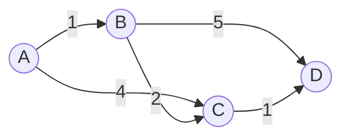
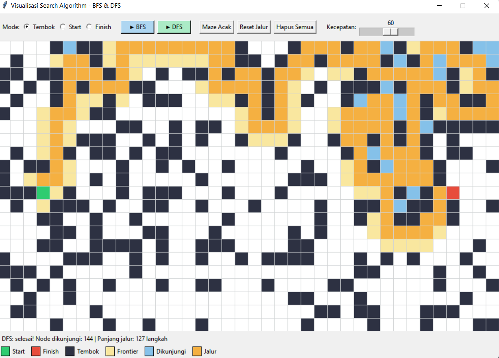

# Visualisasi Search Algorithm pada Grid / Maze

Aplikasi desktop berbasis **Python + Tkinter** untuk memvisualisasikan cara kerja algoritma pencarian (*search algorithm*) **Breadth-First Search (BFS)** dan **Depth-First Search (DFS)** pada sebuah grid/maze secara animasi. Materi ini juga dilengkapi pembahasan **Informed Search** (**A\***, **Dijkstra**, dan **Greedy Best-First**) beserta perbandingan visualisasinya.

---

## Daftar Isi

1. [Apa itu Search Algorithm?](#1-apa-itu-search-algorithm)
2. [Istilah Penting](#2-istilah-penting)
3. [Macam-macam Search Algorithm](#3-macam-macam-search-algorithm)
4. [Penjelasan Algoritma Uninformed Search](#4-penjelasan-algoritma-uninformed-search)
5. [Penjelasan Algoritma Informed Search](#5-penjelasan-algoritma-informed-search)
6. [Algoritma Lokal (Singkat)](#6-algoritma-lokal-singkat)
7. [Perbandingan Algoritma](#7-perbandingan-algoritma)
8. [Tentang Program Ini](#8-tentang-program-ini)
9. [Cara Menjalankan Program](#9-cara-menjalankan-program)
10. [Cara Menggunakan Aplikasi](#10-cara-menggunakan-aplikasi)
11. [Output / Hasil Run](#11-output--hasil-run)
12. [Penjelasan Kode](#12-penjelasan-kode)
13. [Kesimpulan](#13-kesimpulan)

---

## 1. Apa itu Search Algorithm?

**Search algorithm** (algoritma pencarian) adalah algoritma yang dipakai untuk **mencari solusi** dari sebuah masalah dengan menelusuri **ruang keadaan (state space)** dari kondisi awal (*initial state*) sampai mencapai kondisi tujuan (*goal state*).

Contoh penerapannya:

- Mencari rute terpendek di Google Maps
- Pathfinding karakter NPC pada game
- Navigasi robot (misalnya robot line follower atau robot maze)
- Menyelesaikan puzzle (8-puzzle, Rubik, sudoku)
- Routing paket pada jaringan komputer

Pada project ini, masalahnya adalah: **mencari jalur dari sel Start ke sel Finish pada grid yang berisi tembok**.

## 2. Istilah Penting

| Istilah | Arti |
|---|---|
| **State / Node** | Satu kondisi/posisi dalam pencarian (pada project ini: satu sel di grid) |
| **Initial state** | Posisi awal (Start) |
| **Goal state** | Posisi tujuan (Finish) |
| **Frontier / Open list** | Kumpulan node yang sudah ditemukan tetapi belum dikunjungi |
| **Visited / Closed list** | Kumpulan node yang sudah dikunjungi |
| **Parent** | Node asal yang membawa kita ke node saat ini (dipakai untuk menyusun jalur) |
| **Completeness** | Apakah algoritma pasti menemukan solusi jika solusi ada |
| **Optimality** | Apakah solusi yang ditemukan pasti yang terbaik (terpendek / berbiaya terkecil) |
| **Time complexity** | Banyaknya node yang diproses |
| **Space complexity** | Banyaknya memori yang dibutuhkan |

Notasi kompleksitas: `b` = branching factor (jumlah cabang tiap node), `d` = kedalaman solusi terdekat, `m` = kedalaman maksimum, `V` = jumlah vertex, `E` = jumlah edge.

## 3. Macam-macam Search Algorithm

Search algorithm secara umum dibagi menjadi dua kelompok besar:

```
Search Algorithm
|
+-- Uninformed Search (Blind Search)      -> tidak punya informasi tentang letak goal
|     +-- Breadth-First Search (BFS)
|     +-- Depth-First Search (DFS)
|     +-- Depth-Limited Search (DLS)
|     +-- Iterative Deepening Search (IDS / IDDFS)
|     +-- Uniform Cost Search (UCS)
|     +-- Bidirectional Search
|
+-- Informed Search (Heuristic Search)    -> memakai fungsi heuristik h(n)
      +-- Greedy Best-First Search
      +-- A* (A-Star)
      +-- IDA* (Iterative Deepening A*)
      +-- (Hill Climbing, Beam Search, Simulated Annealing, dll.)
```

- **Uninformed search**: hanya tahu struktur masalah, menelusuri secara "buta" tanpa petunjuk arah ke tujuan.
- **Informed search**: memakai **heuristik** (perkiraan jarak ke tujuan) untuk mengarahkan pencarian sehingga biasanya lebih cepat.

## 4. Penjelasan Algoritma Uninformed Search

### 4.1 Breadth-First Search (BFS)

- **Jenis:** Uninformed
- **Struktur data:** **Queue (FIFO)** - masuk pertama, keluar pertama
- **Cara kerja:** menelusuri graf **level per level**. Semua tetangga dari node awal dikunjungi dulu, lalu tetangga dari tetangga, dan seterusnya, melebar seperti riak air.
- **Langkah:**
  1. Masukkan node Start ke queue.
  2. Ambil node paling depan dari queue.
  3. Jika node itu adalah Finish, selesai. Susun jalur dari `parent`.
  4. Jika bukan, masukkan semua tetangga yang belum dikunjungi ke belakang queue (catat parent-nya).
  5. Ulangi langkah 2-4 sampai queue kosong.
- **Complete:** Ya
- **Optimal:** Ya, **menjamin jalur terpendek** jika tiap langkah berbiaya sama
- **Time:** O(V + E) atau O(b^d)
- **Space:** O(V) atau O(b^d) (boros memori)
- **Kelebihan:** pasti menemukan jalur terpendek, cocok untuk grid tanpa bobot
- **Kekurangan:** memori besar karena menyimpan seluruh frontier

### 4.2 Depth-First Search (DFS)

- **Jenis:** Uninformed
- **Struktur data:** **Stack (LIFO)** - masuk terakhir, keluar pertama (atau rekursi)
- **Cara kerja:** masuk **sedalam mungkin** pada satu cabang dulu. Jika buntu, mundur (*backtrack*) lalu coba cabang lain.
- **Langkah:**
  1. Masukkan node Start ke stack.
  2. Ambil (pop) node paling atas dari stack.
  3. Jika sudah pernah dikunjungi, lewati. Jika belum, tandai dikunjungi.
  4. Jika node itu Finish, selesai.
  5. Jika bukan, push semua tetangga yang belum dikunjungi ke stack.
  6. Ulangi sampai stack kosong.
- **Complete:** Ya pada graf berhingga dengan pengecekan visited (tidak complete jika ruang tak hingga atau tanpa cek visited)
- **Optimal:** **Tidak**, jalur yang ditemukan bisa jauh lebih panjang dari jalur terpendek
- **Time:** O(V + E) atau O(b^m)
- **Space:** O(b*m) (hemat memori dibanding BFS)
- **Kelebihan:** hemat memori, bisa cepat jika solusi berada jauh di dalam
- **Kekurangan:** jalur belum tentu terpendek, bisa "tersesat" di cabang yang dalam

### 4.3 Depth-Limited Search (DLS)

DFS yang dibatasi sampai kedalaman tertentu `L`. Mencegah DFS masuk terlalu dalam atau berputar tanpa akhir. Kekurangannya, jika solusi berada lebih dalam dari `L`, solusi tidak akan ditemukan (tidak complete). Time O(b^L), space O(b*L).

### 4.4 Iterative Deepening Search (IDS / IDDFS)

Menjalankan DLS berulang kali dengan batas kedalaman yang dinaikkan bertahap (0, 1, 2, ...). Menggabungkan **kelebihan BFS** (complete dan optimal untuk biaya seragam) dengan **kelebihan DFS** (memori hemat, O(b*d)). Walaupun node level atas dikunjungi berulang, total biayanya tetap O(b^d).

### 4.5 Uniform Cost Search (UCS)

- **Struktur data:** **Priority Queue** berdasarkan biaya jalur `g(n)`
- **Cara kerja:** selalu memperluas node dengan **total biaya dari Start paling kecil**. Pada dasarnya BFS yang mendukung bobot/biaya berbeda tiap langkah (identik dengan algoritma Dijkstra, lihat [bagian 5.2](#52-dijkstra)).
- **Complete:** Ya (biaya langkah > 0) | **Optimal:** Ya
- **Time/Space:** O(b^(1 + C*/e)), dengan C* = biaya solusi optimal dan e = biaya langkah minimum
- **Kekurangan:** tidak punya arah ke goal, sehingga menyebar ke segala arah

### 4.6 Bidirectional Search

Menjalankan **dua pencarian sekaligus**: satu maju dari Start, satu mundur dari Goal, sampai keduanya bertemu di tengah. Kompleksitas turun dari O(b^d) menjadi sekitar O(b^(d/2)). Syarat: goal harus diketahui jelas dan operasi mundur harus bisa dilakukan.

## 5. Penjelasan Algoritma Informed Search

### 5.1 Pengertian dan Konsep Dasar

**Informed Search** (*heuristic search*) adalah algoritma pencarian yang menggunakan **pengetahuan tambahan tentang masalah** untuk memperkirakan seberapa dekat suatu node dengan tujuan. Pengetahuan ini disebut **fungsi heuristik** `h(n)`. Dengan begitu, node yang tampak lebih menjanjikan dikerjakan lebih dulu, sehingga jumlah node yang dikunjungi biasanya jauh lebih sedikit dibanding BFS/DFS.

| | Uninformed (BFS, DFS) | Informed (A\*, Greedy) |
|---|---|---|
| Informasi yang dipakai | Hanya struktur graf | Struktur graf + heuristik `h(n)` |
| Arah pencarian | Melebar / mendalam tanpa tahu tujuan | Terarah ke tujuan |
| Jumlah node dieksplorasi | Banyak | Umumnya lebih sedikit |

> **Catatan tentang Dijkstra:** secara teori, Dijkstra termasuk **Uninformed Search** (setara Uniform Cost Search pada [bagian 4.5](#45-uniform-cost-search-ucs)) karena tidak memakai heuristik. Dijkstra tetap dibahas di sini karena dipakai pada graf **berbobot** seperti A\*, merupakan **kasus khusus A\*** dengan `h(n) = 0`, dan cocok sebagai pembanding untuk melihat **dampak heuristik** pada visualisasi.

**Istilah tambahan** (Open Set = Frontier dan Closed Set = Visited pada [bagian 2](#2-istilah-penting)):

| Istilah | Arti |
|---|---|
| **Open Set** | Node yang sudah ditemukan tetapi belum dieksplorasi (frontier) |
| **Closed Set** | Node yang sudah selesai dieksplorasi (visited) |
| **Priority Queue** | Antrian yang selalu mengeluarkan node dengan nilai terkecil lebih dulu |

**Tiga nilai utama:**

```
f(n) = g(n) + h(n)
```

- `g(n)`: biaya *sebenarnya* dari **Start** ke node `n`.
- `h(n)`: biaya *perkiraan* dari node `n` ke **Goal** (heuristik).
- `f(n)`: total perkiraan biaya jalur yang melewati `n`. Node dengan `f` terkecil dipilih lebih dulu.

**Jenis heuristik pada grid:**

| Heuristik | Rumus | Cocok untuk |
|---|---|---|
| **Manhattan** | `\|x1 - x2\| + \|y1 - y2\|` | Grid, gerakan 4 arah (atas, bawah, kiri, kanan) |
| **Euclidean** | `√((x1 - x2)² + (y1 - y2)²)` | Gerakan bebas ke segala arah |
| **Chebyshev** | `max(\|x1 - x2\|, \|y1 - y2\|)` | Grid, gerakan 8 arah (termasuk diagonal) |

**Syarat heuristik agar A\* optimal:**

- **Admissible**: heuristik *tidak pernah melebihi* biaya sebenarnya (`h(n) ≤ h*(n)`).
- **Consistent** (monotonic): `h(n) ≤ c(n, n') + h(n')`. Syarat ini lebih kuat, dan membuat node yang sudah di-*closed* tidak perlu dibuka ulang.

**Algoritma yang dibahas:**

| Algoritma | Prioritas | Memakai heuristik? | Menjamin jalur terpendek? |
|---|---|:---:|:---:|
| Dijkstra | `g(n)` | Tidak | Ya |
| Greedy Best-First | `h(n)` | Ya | Tidak |
| A\* | `g(n) + h(n)` | Ya | Ya (jika heuristik admissible) |
| IDA\* | `f(n)` dengan batas iteratif | Ya | Ya (jika heuristik admissible) |

### 5.2 Dijkstra

- **Jenis:** Uninformed (berbobot), dibahas di sini sebagai pembanding A\*
- **Struktur data:** **Priority Queue** berdasarkan jarak dari Start `g(n)`
- **Cara kerja:** selalu mengeksplorasi node yang **biaya totalnya dari Start paling kecil**. Tidak ada tebakan arah ke Goal, sehingga pencarian menyebar ke **segala arah**.
- **Langkah:**
  1. Beri semua node jarak `∞`, kecuali Start yang berjarak `0`, lalu masukkan Start ke priority queue.
  2. Ambil node dengan **jarak terkecil** (`current`).
  3. Untuk setiap tetangga, hitung `jarak_baru = jarak[current] + cost`. Jika lebih kecil dari jarak sebelumnya, perbarui jarak dan `parent`, lalu masukkan ke queue (disebut **relaxation**).
  4. Ulangi sampai Goal diambil dari queue (atau sampai semua node selesai, jika ingin jarak ke semua node).
- **Complete:** Ya | **Optimal:** Ya (bobot tidak boleh negatif, gunakan Bellman-Ford untuk bobot negatif)
- **Time:** O((V + E) log V) dengan binary heap | **Space:** O(V)
- **Kelebihan:** menjamin jalur terpendek, tanpa heuristik, bisa menghitung jarak ke semua node sekaligus
- **Kekurangan:** mengeksplorasi terlalu banyak node, lebih lambat dari A\* untuk satu pasang Start-Goal
- **Hubungan dengan A\*:** Dijkstra = A\* dengan `h(n) = 0`, sehingga `f(n) = g(n)`.

### 5.3 Greedy Best-First Search

- **Jenis:** Informed
- **Struktur data:** Priority Queue berdasarkan heuristik `h(n)` saja, yaitu `f(n) = h(n)`
- **Cara kerja:** selalu memilih node yang **tampak paling dekat ke goal** menurut heuristik, tanpa memperhitungkan biaya yang sudah ditempuh.
- **Complete:** Tidak selalu | **Optimal:** **Tidak**
- **Time/Space:** O(b^m) pada kasus terburuk
- **Kelebihan:** sangat cepat dan eksplorasi node sedikit dalam banyak kasus
- **Kekurangan:** bisa terjebak di jalan buntu (misalnya dinding berbentuk "U") dan hasilnya belum tentu terpendek

### 5.4 A\* (A-Star)

- **Jenis:** Informed
- **Struktur data:** Priority Queue berdasarkan `f(n) = g(n) + h(n)`
- **Cara kerja:** menggabungkan UCS/Dijkstra (memperhitungkan biaya yang sudah ditempuh `g`) dengan Greedy (memperkirakan sisa jarak `h`). Selalu mengambil node dengan `f(n)` terkecil.
- **Langkah singkat:**
  1. Masukkan Start ke Open Set dengan `g = 0` dan `f = h(start)`.
  2. Ambil node dengan `f` terkecil. Jika itu Goal, susun jalur dari `parent`.
  3. Pindahkan node ke Closed Set, lalu periksa semua tetangganya (lewati dinding dan node di Closed Set).
  4. Jika `g_baru` tetangga lebih kecil dari `g` sebelumnya, perbarui `g`, `f`, dan `parent`, lalu masukkan ke Open Set.
  5. Ulangi sampai Goal ditemukan atau Open Set kosong (jalur tidak ada).
- **Complete:** Ya | **Optimal:** Ya, **asalkan heuristik admissible** (tidak pernah melebih-lebihkan biaya sebenarnya, `h(n) <= h*(n)`)
- **Time:** tergantung kualitas heuristik, biasanya jauh lebih sedikit node dibanding BFS/UCS
- **Space:** O(b^d), menyimpan semua node di memori
- **Kelebihan:** cepat dan optimal, standar industri untuk pathfinding
- **Kekurangan:** boros memori, hasil sangat bergantung pada pemilihan heuristik

**Flowchart A\*:**


**Pseudocode:**

```text
open_list  <- {start}
g[start]   <- 0
f[start]   <- h(start)
while open_list tidak kosong:
    n <- node pada open_list dengan f terkecil
    if n == goal: return susun_jalur(n)
    pindahkan n ke closed_list
    for setiap tetangga m dari n:
        g_baru <- g[n] + biaya(n, m)
        if m belum pernah dikunjungi atau g_baru < g[m]:
            parent[m] <- n
            g[m] <- g_baru
            f[m] <- g_baru + h(m)
            masukkan m ke open_list
return gagal
```

### 5.5 IDA\* (Iterative Deepening A\*)

Gabungan IDS dan A\*. Pencarian DFS dibatasi oleh nilai `f(n)` (bukan kedalaman), dan batas itu dinaikkan bertahap. Tetap optimal seperti A\* tetapi memori jauh lebih hemat, O(b*d).

### 5.6 Contoh Perhitungan Manual

Graf berbobot dengan Start = **A** dan Goal = **D**:



Nilai heuristik (admissible dan consistent):

| Node | A | B | C | D |
|---|:---:|:---:|:---:|:---:|
| `h(n)` | 3 | 3 | 1 | 0 |

**A\* (`f = g + h`):**

| Langkah | Node diambil | Tetangga yang diperbarui | Open Set (node : f) |
|:---:|:---:|---|---|
| 1 | **A** (f=3) | B: g=1, f=4 · C: g=4, f=5 | B:4, C:5 |
| 2 | **B** (f=4) | C: g=3 (lebih kecil dari 4), f=4 · D: g=6, f=6 | C:4, D:6 |
| 3 | **C** (f=4) | D: g=4 (lebih kecil dari 6), f=4 | D:4 |
| 4 | **D** (Goal) | - | - |

**Jalur: A → B → C → D, total biaya = 4** (optimal)

**Greedy Best-First (`f = h`):**

| Langkah | Node diambil | Keterangan |
|:---:|:---:|---|
| 1 | **A** | Tetangga: B (h=3), C (h=1) |
| 2 | **C** (h=1, terkecil) | Tetangga: D (h=0) |
| 3 | **D** (Goal) | - |

**Jalur: A → C → D, total biaya = 5** (bukan yang terpendek)

> Greedy langsung memilih C karena tampak lebih dekat ke Goal, tetapi lupa bahwa jalur A→C mahal (biaya 4). A\* memperhitungkan `g` sehingga menemukan jalur yang lebih murah.

### 5.7 Visualisasi Informed Search

Pada grid, setiap sel digambarkan sebagai node, dengan **warna yang sama seperti aplikasi** pada [bagian 8](#8-tentang-program-ini): hijau (Start), merah (Finish), kuning muda (frontier / Open Set), biru muda (visited / Closed Set), dan oranye (jalur hasil pencarian).

**Ilustrasi sederhana** (`S` = Start, `G` = Goal, `#` = dinding, `*` = jalur, `o` = node yang dieksplorasi):

```text
Dijkstra (menyebar ke segala arah)    A* (terarah ke Goal)
o o o o o o o o                       . . . . . . . .
o o o o o o o o                       . . . o o o . .
o o S * * * * o                       . . S * * * * .
o o o o # # * o                       . . o o # # * .
o o o o # G * o                       . . . . # G * .
o o o o o o o o                       . . . . . . . .

Node dieksplorasi: banyak             Node dieksplorasi: sedikit
```

**Pola yang diamati pada visualisasi:**

| Algoritma | Pola eksplorasi | Hasil jalur |
|---|---|---|
| **BFS** (bagian 11.1) | Menyebar merata level demi level | Terpendek (biaya seragam) |
| **Dijkstra** | Menyebar **melingkar** dari Start ke segala arah | Terpendek |
| **A\*** | Menyempit dan **condong ke arah Goal** | Terpendek |
| **Greedy** | **Langsung lurus** ke Goal, bisa tersangkut dinding | Belum tentu terpendek |
| **DFS** (bagian 11.2) | Masuk sedalam mungkin ke satu arah | Tidak optimal |

**Cara membaca visualisasi:**

1. **Luas area biru muda** (visited) menunjukkan banyaknya node yang diperiksa. Semakin sedikit, semakin efisien.
2. **Bentuk frontier**: Dijkstra membentuk "gelombang" melingkar, A\* membentuk "panah" ke arah Goal.
3. **Jalur oranye** muncul hanya setelah Goal ditemukan, dengan menelusuri `parent` dari Goal ke Start.
4. Coba **tambahkan dinding berbentuk "U"** di depan Goal. Greedy akan terjebak dan memutar jauh, sedangkan A\* tetap menemukan jalur terpendek.

**Contoh kode inti A\* (Python, contoh terpisah dari aplikasi):**

```python
import heapq

def heuristic(a, b):
    # Manhattan distance
    return abs(a[0] - b[0]) + abs(a[1] - b[1])

def a_star(grid, start, goal):
    rows, cols = len(grid), len(grid[0])
    open_set = [(heuristic(start, goal), 0, start)]   # (f, g, node)
    parent = {}
    g_score = {start: 0}
    closed = set()
    visited_order = []                                # urutan node untuk animasi

    while open_set:
        f, g, current = heapq.heappop(open_set)
        if current in closed:
            continue
        closed.add(current)
        visited_order.append(current)

        if current == goal:
            path = [current]
            while current in parent:
                current = parent[current]
                path.append(current)
            return path[::-1], visited_order

        r, c = current
        for dr, dc in [(1, 0), (-1, 0), (0, 1), (0, -1)]:
            nr, nc = r + dr, c + dc
            if 0 <= nr < rows and 0 <= nc < cols and grid[nr][nc] == 0:
                neighbor = (nr, nc)
                new_g = g + 1
                if new_g < g_score.get(neighbor, float("inf")):
                    g_score[neighbor] = new_g
                    parent[neighbor] = current
                    f_new = new_g + heuristic(neighbor, goal)
                    heapq.heappush(open_set, (f_new, new_g, neighbor))

    return None, visited_order
```

Mengubah A\* menjadi **Dijkstra** cukup dengan membuat heuristik selalu nol, dan menjadi **Greedy** dengan memakai `h` saja sebagai prioritas:

```python
# Dijkstra: f(n) = g(n)
def heuristic(a, b):
    return 0

# Greedy Best-First: f(n) = h(n)
f_new = heuristic(neighbor, goal)
```

> `visited_order` dan `path` bisa dipakai untuk animasi (misalnya dengan `tkinter` seperti pada aplikasi ini): gambar `visited_order` satu per satu, lalu gambar `path` di akhir.

### 5.8 Efisiensi (Kompleksitas)

| Algoritma | Waktu | Memori | Complete | Optimal |
|---|---|---|:---:|:---:|
| **Dijkstra** (binary heap) | `O((V + E) log V)` | `O(V)` | Ya | Ya (bobot ≥ 0) |
| **A\*** | `O(b^d)` kasus terburuk, jauh lebih cepat dengan heuristik bagus | `O(b^d)` | Ya | Ya (heuristik admissible) |
| **Greedy Best-First** | `O(b^m)` kasus terburuk | `O(b^m)` | Tidak | Tidak |

Poin efisiensi:

- **Kualitas heuristik menentukan kecepatan A\***. Semakin dekat `h(n)` dengan biaya sebenarnya (tanpa melebihinya), semakin sedikit node yang dieksplorasi.
- Jika `h(n) = 0`, A\* menjadi **Dijkstra** (eksplorasi paling banyak).
- Jika `h(n)` *melebihi* biaya sebenarnya (non-admissible), A\* lebih cepat tetapi **kehilangan jaminan optimal**.
- **Memori** adalah kendala utama A\*, karena semua node di Open dan Closed Set disimpan.
- Gunakan **priority queue (heap)**. Memakai list biasa memperlambat pencarian menjadi `O(V²)`.

### 5.9 Kelebihan dan Kekurangan

| Algoritma | Kelebihan | Kekurangan |
|---|---|---|
| **A\*** | Optimal (heuristik admissible), lebih efisien dari Dijkstra karena terarah, complete, fleksibel (bisa jadi Dijkstra atau Greedy) | Memori besar, bergantung pada heuristik, lebih lambat dari Greedy pada kasus sederhana |
| **Dijkstra** | Optimal, tidak perlu heuristik, menghitung jarak ke semua node, sederhana | Eksplorasi terlalu banyak node, tidak mendukung bobot negatif, lebih lambat dari A\* untuk satu pasang Start-Goal |
| **Greedy** | Sangat cepat, eksplorasi node sedikit, implementasi sederhana | Tidak menjamin jalur terpendek, mudah terjebak rintangan (local optimum) |

## 6. Algoritma Lokal (Singkat)

Mencari solusi dengan memperbaiki satu kondisi saat ini tanpa menyimpan jalur:

- **Hill Climbing**: selalu pindah ke tetangga yang lebih baik, bisa terjebak di *local maximum*.
- **Simulated Annealing**: kadang menerima langkah yang lebih buruk agar bisa lolos dari local maximum.
- **Beam Search**: hanya menyimpan `k` node terbaik di tiap level.
- **Genetic Algorithm**: pencarian berbasis populasi dan seleksi alam.

## 7. Perbandingan Algoritma

| Algoritma | Jenis | Struktur Data | Complete | Optimal | Time | Space |
|---|---|---|---|---|---|---|
| BFS | Uninformed | Queue (FIFO) | Ya | Ya (biaya seragam) | O(b^d) | O(b^d) |
| DFS | Uninformed | Stack (LIFO) | Ya* | Tidak | O(b^m) | O(b*m) |
| DLS | Uninformed | Stack | Tidak | Tidak | O(b^L) | O(b*L) |
| IDS | Uninformed | Stack | Ya | Ya (biaya seragam) | O(b^d) | O(b*d) |
| UCS | Uninformed | Priority Queue (g) | Ya | Ya | O(b^(1+C*/e)) | O(b^(1+C*/e)) |
| Dijkstra† | Uninformed (berbobot) | Priority Queue (g) | Ya | Ya (bobot non-negatif) | O((V+E) log V) | O(V) |
| Bidirectional | Uninformed | 2 Queue | Ya | Ya (biaya seragam) | O(b^(d/2)) | O(b^(d/2)) |
| Greedy Best-First | Informed | Priority Queue (h) | Tidak | Tidak | O(b^m) | O(b^m) |
| A* | Informed | Priority Queue (g+h) | Ya | Ya (heuristik admissible) | tergantung h | O(b^d) |
| IDA* | Informed | Stack | Ya | Ya (heuristik admissible) | tergantung h | O(b*d) |

\* pada graf berhingga dengan pengecekan visited.

† Dijkstra setara UCS, dibahas bersama A\* pada [bagian 5](#5-penjelasan-algoritma-informed-search) sebagai pembanding.

**Algoritma yang diimplementasikan di aplikasi pada project ini: BFS dan DFS.**

## 8. Tentang Program Ini

Program memvisualisasikan **BFS** dan **DFS** pada grid berukuran **22 baris x 38 kolom**. Pengguna bebas menggambar tembok, memindahkan Start dan Finish, atau membuat maze acak, lalu membandingkan perilaku kedua algoritma secara animasi.

**Fitur:**

- Menggambar dan menghapus tembok dengan klik/drag mouse
- Memindahkan posisi Start dan Finish
- Generate maze acak
- Animasi pencarian BFS dan DFS
- Pengaturan kecepatan animasi
- Menampilkan jumlah node yang dikunjungi dan panjang jalur

**Legenda warna:**

| Warna | Arti |
|---|---|
| Hijau | Start |
| Merah | Finish |
| Biru tua keabu-abuan | Tembok |
| Kuning muda | Frontier (node yang masuk antrian/stack) |
| Biru muda | Node yang sudah dikunjungi |
| Oranye | Jalur hasil pencarian |

## 9. Cara Menjalankan Program

### Prasyarat

- **Python 3.8 atau lebih baru**
- **Tkinter** (sudah bawaan Python di Windows dan macOS)
- Tidak perlu install library tambahan (hanya memakai library standar: `tkinter`, `random`, `collections`)

> Program ini adalah **aplikasi GUI desktop**, jadi harus dijalankan di komputer lokal. Tidak bisa dijalankan di Google Colab, Jupyter Notebook, atau langsung di GitHub karena membutuhkan jendela layar.

### Langkah-langkah

**1. Cek versi Python**

```bash
python --version
```

(Di Linux/macOS bisa jadi perintahnya `python3 --version`.)

**2. Cek Tkinter**

```bash
python -m tkinter
```

Jika muncul jendela kecil bertuliskan "This is Tcl/Tk version ...", berarti Tkinter sudah siap. Jika error di Linux (Ubuntu/Debian), install dengan:

```bash
sudo apt update
sudo apt install python3-tk
```

**3. Dapatkan source code**

```bash
git clone https://github.com/<username>/<nama-repo>.git
cd <nama-repo>
```

Atau download file `main.py` langsung lalu buka terminal di folder tersebut.

**4. Jalankan program**

```bash
# Windows
python main.py

# Linux / macOS
python3 main.py
```

Jendela aplikasi **"Visualisasi Search Algorithm - BFS & DFS"** akan muncul.

**5. (Opsional) Menjalankan lewat VS Code**

Buka folder project di VS Code, buka `main.py`, lalu klik tombol **Run Python File** (segitiga di kanan atas) atau tekan `F5`.

## 10. Cara Menggunakan Aplikasi

1. Pilih **Mode** di bagian atas: **Tembok**, **Start**, atau **Finish**.
2. **Klik / drag kiri** di grid untuk memasang tembok, atau memindahkan Start/Finish sesuai mode.
3. **Klik / drag kanan** untuk menghapus tembok.
4. Tekan **Maze Acak** jika ingin tembok dibuat otomatis.
5. Atur slider **Kecepatan** sesuai keinginan.
6. Tekan **▶ BFS** atau **▶ DFS** untuk memulai animasi pencarian.
7. Gunakan **Reset Jalur** untuk menghapus hasil pencarian (tembok tetap), atau **Hapus Semua** untuk mengosongkan grid.

## 11. Output / Hasil Run

Bagian ini menampilkan hasil eksekusi program yang diambil langsung dari aplikasi (screenshot asli) untuk algoritma BFS dan DFS. Keduanya dijalankan pada grid 22 x 38 dengan kecepatan animasi 60, Start di sisi kiri (hijau) dan Finish di sisi kanan (merah).

### 11.1 Output BFS


```text
BFS: selesai! Node dikunjungi: 550 | Panjang jalur: 43 langkah
```

Pengamatan:

- Area biru (node dikunjungi) menyebar **merata ke hampir seluruh grid**, karena BFS menelusuri level demi level ke segala arah.
- Jalur oranye relatif **lurus dan efisien** dari Start ke Finish.
- Masih tersisa beberapa sel kuning (frontier) dan putih (belum dikunjungi) di sisi kanan, karena pencarian berhenti begitu Finish ditemukan.

### 11.2 Output DFS



```text
DFS: selesai! Node dikunjungi: 144 | Panjang jalur: 127 langkah
```

Pengamatan:

- Node yang dikunjungi **tidak menyebar merata**, melainkan masuk dalam satu arah ke area atas dan kanan grid terlebih dahulu.
- Jalur oranye **berkelok-kelok dan sangat panjang**, karena DFS mengikuti satu cabang sedalam mungkin dan berhenti begitu menemukan Finish, tanpa mencari jalur yang lebih pendek.
- Sebagian besar area kiri bawah grid tidak tersentuh sama sekali.

### 11.3 Tabel Perbandingan Hasil

| Algoritma | Node Dikunjungi | Panjang Jalur | Keterangan |
|---|---|---|---|
| BFS | 550 | 43 langkah | Jalur **terpendek**, tetapi menjelajah banyak node (melebar) |
| DFS | 144 | 127 langkah | Node yang dikunjungi lebih sedikit, tetapi jalur **jauh lebih panjang** (tidak optimal) |

> **Catatan:** kedua screenshot diambil dari maze acak yang **berbeda** (tombol **Maze Acak** ditekan sebelum masing-masing run), sehingga jumlah node yang dikunjungi tidak bisa dibandingkan secara langsung. Yang bisa diambil sebagai kesimpulan adalah **karakteristik** masing-masing algoritma: BFS menghasilkan jalur pendek dengan eksplorasi luas, sedangkan DFS menghasilkan jalur panjang yang berkelok. Untuk perbandingan yang adil, jalankan BFS lalu klik **Reset Jalur** (jangan tekan Maze Acak), kemudian jalankan DFS pada maze yang sama.

### 11.4 Analisis Hasil

- **BFS** menemukan jalur sepanjang **43 langkah**. Karena BFS memakai **queue (FIFO)** dan memperluas pencarian level demi level, Finish pasti ditemukan lewat jalur dengan langkah paling sedikit. Harganya, BFS harus mengunjungi banyak node (550) dan menyimpan frontier yang besar di memori.
- **DFS** menemukan jalur sepanjang **127 langkah**, hampir **3 kali lebih panjang** daripada jalur BFS. Karena DFS memakai **stack (LIFO)**, ia masuk sedalam mungkin ke satu arah dan berhenti begitu Finish ketemu, tanpa peduli apakah itu jalur terbaik.
- Jumlah node yang dikunjungi DFS bisa lebih sedikit maupun lebih banyak dari BFS, tergantung bentuk maze dan posisi Finish. Yang konsisten adalah: **BFS selalu menghasilkan jalur terpendek, DFS tidak**.

## 12. Penjelasan Kode

Struktur file:

```
.
├── main.py
├── README.md
├── hasil_bfs.png
└── hasil_dfs.png
```

### Pengaturan

```python
ROWS, COLS, CELL = 22, 38, 26   # jumlah baris, kolom, ukuran 1 sel (piksel)
DIRS = ((-1, 0), (0, 1), (1, 0), (0, -1))   # atas, kanan, bawah, kiri
```

### Algoritma sebagai Generator

`bfs()` dan `dfs()` ditulis sebagai **generator** (memakai `yield`). Tiap `yield` mengembalikan `(node_yang_dikunjungi, [node_baru_masuk_frontier])`, sehingga GUI bisa menggambar **satu langkah per frame** dan terlihat seperti animasi. Yield terakhir bernilai `("done", path)`, dengan `path = None` jika jalur tidak ditemukan.

| Fungsi | Peran |
|---|---|
| `neighbors(cell, walls)` | Mengembalikan tetangga valid (4 arah, di dalam grid, bukan tembok) |
| `build_path(parent, end)` | Menyusun jalur dari Finish mundur ke Start lewat dictionary `parent`, lalu dibalik |
| `bfs(start, end, walls)` | BFS dengan `deque` sebagai **queue** (`popleft()` = FIFO) |
| `dfs(start, end, walls)` | DFS dengan `list` sebagai **stack** (`pop()` = LIFO) |

### Inti BFS

```python
queue = deque([start])
parent = {start: None}
while queue:
    cur = queue.popleft()          # ambil dari depan (FIFO)
    if cur == end: ...             # ketemu, susun jalur
    for nb in neighbors(cur, walls):
        if nb not in parent:       # belum pernah ditemukan
            parent[nb] = cur
            queue.append(nb)       # masuk belakang antrian
```

### Inti DFS

```python
stack = [(start, None)]
while stack:
    cur, par = stack.pop()         # ambil dari atas (LIFO)
    if cur in visited: continue
    visited.add(cur)
    parent[cur] = par
    if cur == end: ...             # ketemu, susun jalur
    for nb in reversed(list(neighbors(cur, walls))):
        if nb not in visited:
            stack.append((nb, cur))
```

### Class `App` (GUI)

| Method | Fungsi |
|---|---|
| `_build_ui()` | Membuat toolbar, canvas, label info, dan legenda |
| `draw_all()`, `draw_cell()`, `paint()` | Menggambar grid dan mewarnai sel |
| `on_left()`, `on_right()` | Menangani klik/drag mouse |
| `random_maze()` | Membuat tembok acak (kepadatan 28%) |
| `run()` | Memulai algoritma yang dipilih |
| `step()` | Mengambil satu langkah dari generator dan menjadwalkan langkah berikutnya dengan `root.after()` |
| `animate_path()` | Menganimasikan jalur akhir berwarna oranye |

## 13. Kesimpulan

- Search algorithm adalah dasar dalam menyelesaikan masalah pencarian pada AI, game, robotika, dan jaringan.
- **BFS** cocok jika membutuhkan **jalur terpendek** pada grid tanpa bobot, dengan konsekuensi memori lebih besar.
- **DFS** cocok jika memori terbatas atau yang dibutuhkan hanya **ada/tidaknya jalur**, bukan jalur terpendek.
- **Dijkstra** menjamin jalur terpendek pada graf berbobot tanpa heuristik, tetapi mengeksplorasi lebih banyak node karena menyebar ke segala arah. Ia adalah **A\* dengan `h(n) = 0`**.
- **Greedy Best-First** sangat cepat karena langsung menuju goal, tetapi **tidak menjamin hasil terbaik** dan mudah tersangkut rintangan.
- **A\*** adalah pengembangan lanjutan yang menggabungkan keunggulan UCS dan heuristik, sehingga **optimal sekaligus efisien**, dan menjadi pilihan utama untuk pathfinding nyata.
- Pada visualisasi, perbedaannya terlihat jelas: BFS dan Dijkstra menyebar melebar, A\* terarah ke goal, Greedy lurus ke goal, dan DFS masuk sedalam mungkin.
- Pemilihan algoritma bergantung pada kebutuhan: optimalitas, kecepatan, dan batasan memori.

## Referensi

- Russell, S. & Norvig, P. *Artificial Intelligence: A Modern Approach*. Pearson.
- Cormen, T. H. et al. *Introduction to Algorithms*. MIT Press.
- Hart, P., Nilsson, N., & Raphael, B. (1968). *A Formal Basis for the Heuristic Determination of Minimum Cost Paths*.
- Dijkstra, E. W. (1959). *A Note on Two Problems in Connexion with Graphs*.
- Red Blob Games: *Introduction to the A\* Algorithm* <https://www.redblobgames.com/pathfinding/a-star/introduction.html>
- Dokumentasi Python: <https://docs.python.org/3/library/tkinter.html>
