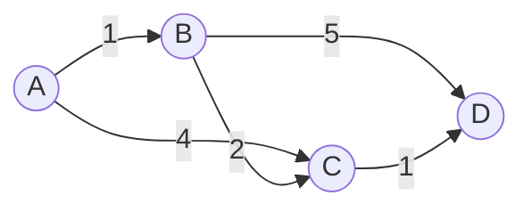

## 🧭 Informed Search Algorithm (Visualisasi A\* dan Dijkstra)

> Bagian ini membahas visualisasi **Informed Search**, yaitu algoritma pencarian yang memakai *informasi tambahan* (heuristik) untuk memilih jalur.
---

## 📑 Daftar Isi
1. [Pengertian](#1-pengertian)
2. [Konsep Dasar](#2-konsep-dasar)
3. [Algoritma yang Dibahas](#3-algoritma-yang-dibahas)
4. [Cara Kerja A\*](#4-cara-kerja-a)
5. [Cara Kerja Dijkstra](#5-cara-kerja-dijkstra)
6. [Greedy Best-First Search](#6-greedy-best-first-search)
7. [Contoh Perhitungan Manual](#7-contoh-perhitungan-manual)
8. [Visualisasi Algoritma](#8-visualisasi-algoritma)
9. [Efisiensi (Kompleksitas)](#9-efisiensi-kompleksitas)
10. [Kelebihan dan Kekurangan](#10-kelebihan-dan-kekurangan)
11. [Perbandingan Seluruh Algoritma](#11-perbandingan-seluruh-algoritma)
12. [Penerapan di Dunia Nyata](#12-penerapan-di-dunia-nyata)
13. [Kesimpulan](#13-kesimpulan)

---

## 1. Pengertian

**Informed Search** (*heuristic search*) adalah algoritma pencarian yang menggunakan **pengetahuan tambahan tentang masalah** untuk memperkirakan seberapa dekat suatu node dengan tujuan. Pengetahuan ini disebut **fungsi heuristik** `h(n)`.

Berbeda dengan BFS dan DFS yang mencari secara "buta" (hanya tahu struktur graf), Informed Search bisa **memprioritaskan node yang tampak lebih menjanjikan**. Akibatnya, jumlah node yang perlu dikunjungi biasanya jauh lebih sedikit.

| | Uninformed (BFS, DFS) | Informed (A\*, Greedy) |
|---|---|---|
| Informasi yang dipakai | Hanya struktur graf | Struktur graf + heuristik `h(n)` |
| Arah pencarian | Melebar / mendalam tanpa tahu tujuan | Terarah ke tujuan |
| Jumlah node dieksplorasi | Banyak | Umumnya lebih sedikit |

> ⚠️ **Catatan penting tentang Dijkstra**
> Secara teori, **Dijkstra termasuk Uninformed Search** (disebut juga *Uniform-Cost Search*) karena tidak memakai heuristik. Dijkstra tetap dibahas di sini karena:
> - dipakai pada graf **berbobot**, sama seperti A\*,
> - merupakan **kasus khusus A\*** dengan `h(n) = 0`,
> - cocok sebagai pembanding untuk melihat **dampak heuristik** pada visualisasi.

---

## 2. Konsep Dasar

### Istilah penting

| Istilah | Arti |
|---|---|
| **Node** | Titik / kotak pada graf atau grid |
| **Edge / Cost** | Biaya berpindah dari satu node ke node lain |
| **Start** | Node awal |
| **Goal** | Node tujuan |
| **Open Set** (*frontier*) | Node yang sudah ditemukan tetapi belum dieksplorasi |
| **Closed Set** (*explored*) | Node yang sudah selesai dieksplorasi |
| **Priority Queue** | Antrian yang selalu mengeluarkan node dengan nilai terkecil lebih dulu |

### Tiga nilai utama pada A\*

```
f(n) = g(n) + h(n)
```

- **`g(n)`**: biaya *sebenarnya* dari **Start** ke node `n`.
- **`h(n)`**: biaya *perkiraan* dari node `n` ke **Goal** (heuristik).
- **`f(n)`**: total perkiraan biaya jalur yang melewati `n`. Node dengan `f` terkecil dipilih lebih dulu.

### Jenis heuristik pada grid

| Heuristik | Rumus | Cocok untuk |
|---|---|---|
| **Manhattan** | `\|x1 - x2\| + \|y1 - y2\|` | Grid, gerakan 4 arah (atas, bawah, kiri, kanan) |
| **Euclidean** | `√((x1 - x2)² + (y1 - y2)²)` | Gerakan bebas ke segala arah |
| **Chebyshev** | `max(\|x1 - x2\|, \|y1 - y2\|)` | Grid, gerakan 8 arah (termasuk diagonal) |

### Syarat heuristik agar A\* optimal

- **Admissible**: heuristik *tidak pernah melebihi* biaya sebenarnya (`h(n) ≤ h*(n)`).
- **Consistent** (monotonic): `h(n) ≤ c(n, n') + h(n')`. Syarat ini lebih kuat, dan membuat node yang sudah di-*closed* tidak perlu dibuka ulang.

---

## 3. Algoritma yang Dibahas

| Algoritma | Rumus prioritas | Memakai heuristik? | Menjamin jalur terpendek? |
|---|---|:---:|:---:|
| **Dijkstra** | `g(n)` | ❌ | ✅ |
| **Greedy Best-First Search** | `h(n)` | ✅ | ❌ |
| **A\* (A-Star)** | `g(n) + h(n)` | ✅ | ✅ (jika heuristik admissible) |

---

## 4. Cara Kerja A\*

A\* menggabungkan keunggulan **Dijkstra** (memperhatikan biaya yang sudah ditempuh `g`) dan **Greedy** (memperhatikan perkiraan jarak ke tujuan `h`).

### Langkah-langkah

1. Masukkan node **Start** ke **Open Set** dengan `g = 0`, `f = h(start)`.
2. **Ulangi** selama Open Set tidak kosong:
   1. Ambil node dengan **`f` terkecil** dari Open Set (sebut `current`).
   2. Jika `current` adalah **Goal**, selesai. Susun jalur dengan menelusuri *parent* dari Goal sampai Start.
   3. Pindahkan `current` ke **Closed Set**.
   4. Untuk setiap **tetangga** dari `current`:
      - Lewati jika tetangga adalah dinding atau sudah ada di Closed Set.
      - Hitung `g_baru = g(current) + cost(current, tetangga)`.
      - Jika tetangga belum ada di Open Set **atau** `g_baru` lebih kecil dari `g` sebelumnya:
        - perbarui `g`, `f = g + h`, dan `parent = current`,
        - masukkan tetangga ke Open Set.
3. Jika Open Set habis dan Goal belum tercapai, **jalur tidak ada**.

### Flowchart


### Pseudocode

```text
function A_STAR(start, goal):
    open_set  ← priority queue berisi (f = h(start), start)
    g[start]  ← 0
    parent    ← {}
    closed    ← {}

    while open_set tidak kosong:
        current ← pop node dengan f terkecil
        if current == goal:
            return rekonstruksi_jalur(parent, current)

        closed.add(current)
        for neighbor in tetangga(current):
            if neighbor in closed: continue
            g_baru ← g[current] + cost(current, neighbor)
            if g_baru < g.get(neighbor, ∞):
                parent[neighbor] ← current
                g[neighbor]     ← g_baru
                f ← g_baru + h(neighbor)
                push (f, neighbor) ke open_set

    return "tidak ada jalur"
```

---

## 5. Cara Kerja Dijkstra

Dijkstra mencari jalur terpendek dengan selalu mengeksplorasi node yang **biaya totalnya dari Start paling kecil** (`g(n)`). Tidak ada tebakan arah ke Goal, sehingga pencarian menyebar ke **segala arah**.

### Langkah-langkah

1. Beri semua node jarak `∞`, kecuali Start yang berjarak `0`.
2. Masukkan Start ke priority queue.
3. **Ulangi**:
   1. Ambil node dengan **jarak terkecil** (`current`).
   2. Untuk setiap tetangga, hitung `jarak_baru = jarak[current] + cost`.
   3. Jika `jarak_baru < jarak[tetangga]`, perbarui jarak dan *parent*, lalu masukkan ke queue (proses ini disebut **relaxation**).
4. Berhenti saat Goal diambil dari queue (atau saat semua node selesai, jika ingin jarak ke semua node).

> 💡 **Dijkstra = A\* dengan `h(n) = 0`.** Itu sebabnya `f(n) = g(n)`.

> ⚠️ Dijkstra **tidak bisa** dipakai pada graf dengan **bobot negatif** (gunakan Bellman-Ford).

---

## 6. Greedy Best-First Search

Greedy hanya melihat **heuristik**: `f(n) = h(n)`. Node yang *tampak* paling dekat dengan Goal selalu dipilih lebih dulu, tanpa memedulikan biaya yang sudah ditempuh.

- ✅ Sangat cepat dan hemat eksplorasi.
- ❌ Bisa tertipu oleh rintangan (misalnya dinding berbentuk "U") dan **tidak menjamin jalur terpendek**.

---

## 7. Contoh Perhitungan Manual

Graf berbobot dengan Start = **A** dan Goal = **D**:



Nilai heuristik (admissible dan consistent):

| Node | A | B | C | D |
|---|:---:|:---:|:---:|:---:|
| `h(n)` | 3 | 3 | 1 | 0 |

### A\*

| Langkah | Node diambil | Tetangga yang diperbarui | Open Set (node : f) |
|:---:|:---:|---|---|
| 1 | **A** (f=3) | B: g=1, f=4 · C: g=4, f=5 | B:4, C:5 |
| 2 | **B** (f=4) | C: g=3 (lebih kecil dari 4), f=4 · D: g=6, f=6 | C:4, D:6 |
| 3 | **C** (f=4) | D: g=4 (lebih kecil dari 6), f=4 | D:4 |
| 4 | **D** (Goal ✅) | - | - |

**Jalur: A → B → C → D, total biaya = 4** ✅ (optimal)

### Greedy Best-First (`f = h`)

| Langkah | Node diambil | Keterangan |
|:---:|:---:|---|
| 1 | **A** | Tetangga: B (h=3), C (h=1) |
| 2 | **C** (h=1, terkecil) | Tetangga: D (h=0) |
| 3 | **D** (Goal ✅) | - |

**Jalur: A → C → D, total biaya = 5** ❌ (bukan yang terpendek)

> Greedy langsung memilih C karena tampak lebih dekat ke Goal, tetapi lupa bahwa jalur A→C mahal (biaya 4). A\* memperhitungkan `g` sehingga menemukan jalur yang lebih murah.

---

## 8. Visualisasi Algoritma

Pada grid, setiap sel digambarkan sebagai node. Visualisasi membantu kita **melihat langsung perbedaan perilaku** tiap algoritma.

### Legenda warna

| Warna | Arti |
|:---:|---|
| 🟩 Hijau | **Start** |
| 🟥 Merah | **Goal** |
| ⬛ Hitam | **Dinding / rintangan** |
| 🟦 Biru muda | **Open Set** (frontier: sudah ditemukan, belum diproses) |
| 🟪 Ungu / biru tua | **Closed Set** (sudah dieksplorasi) |
| 🟨 Kuning | **Jalur akhir** (hasil pencarian) |

> Sesuaikan tabel ini dengan warna yang benar-benar dipakai pada program kalian.

### Contoh ilustrasi sederhana (teks)

`S` = Start, `G` = Goal, `#` = dinding, `*` = jalur, `o` = node yang dieksplorasi

```text
Dijkstra (menyebar ke segala arah)    A* (terarah ke Goal)
o o o o o o o o                       . . . . . . . .
o o o o o o o o                       . . . . . . . .
o o S * * * * o                       . . S * * * * .
o o o o # # * o                       . . . . # # * .
o o o o # G * o                       . . . . # G * .
o o o o o o o o                       . . . . . . . .

Node dieksplorasi: banyak             Node dieksplorasi: sedikit
```

### Yang perlu diamati saat visualisasi

| Algoritma | Pola eksplorasi | Hasil jalur |
|---|---|---|
| **Dijkstra** | Menyebar **melingkar** dari Start ke segala arah | Terpendek ✅ |
| **A\*** | Menyempit dan **condong ke arah Goal** | Terpendek ✅ |
| **Greedy** | **Langsung lurus** ke Goal, bisa tersangkut dinding | Belum tentu terpendek ❌ |

### Cara membaca visualisasi

1. **Pelebaran area biru/ungu** menunjukkan seberapa banyak node yang harus diperiksa. Semakin sedikit, semakin efisien.
2. **Bentuk frontier**: Dijkstra membentuk "gelombang" melingkar, A\* membentuk "panah" ke arah Goal.
3. **Jalur kuning** muncul hanya setelah Goal ditemukan, dengan menelusuri *parent* dari Goal ke Start.
4. Coba **tambahkan dinding berbentuk "U"** di depan Goal. Greedy akan terjebak dan memutar jauh, sedangkan A\* tetap menemukan jalur terpendek.

### Contoh kode inti (Python)

```python
import heapq

def heuristic(a, b):
    # Manhattan distance
    return abs(a[0] - b[0]) + abs(a[1] - b[1])

def a_star(grid, start, goal):
    rows, cols = len(grid), len(grid[0])
    open_set = [(heuristic(start, goal), 0, start)]   # (f, g, node)
    parent = {}
    g_score = {start: 0}
    closed = set()
    visited_order = []                                # urutan node untuk animasi

    while open_set:
        f, g, current = heapq.heappop(open_set)
        if current in closed:
            continue
        closed.add(current)
        visited_order.append(current)

        if current == goal:
            path = [current]
            while current in parent:
                current = parent[current]
                path.append(current)
            return path[::-1], visited_order

        r, c = current
        for dr, dc in [(1, 0), (-1, 0), (0, 1), (0, -1)]:
            nr, nc = r + dr, c + dc
            if 0 <= nr < rows and 0 <= nc < cols and grid[nr][nc] == 0:
                neighbor = (nr, nc)
                new_g = g + 1
                if new_g < g_score.get(neighbor, float("inf")):
                    g_score[neighbor] = new_g
                    parent[neighbor] = current
                    f_new = new_g + heuristic(neighbor, goal)
                    heapq.heappush(open_set, (f_new, new_g, neighbor))

    return None, visited_order
```

**Mengubah A\* menjadi Dijkstra** cukup dengan membuat heuristik selalu nol:

```python
def heuristic(a, b):
    return 0   # f(n) = g(n) → Dijkstra
```

**Mengubah A\* menjadi Greedy** cukup dengan memakai `h` saja sebagai prioritas:

```python
f_new = heuristic(neighbor, goal)   # f(n) = h(n) → Greedy Best-First
```

> Simpan `visited_order` dan `path` untuk dipakai oleh bagian animasi (misalnya `pygame`, `matplotlib`, atau `tkinter`), sehingga setiap langkah bisa digambar satu per satu.

> 📎 Implementasi lengkap beserta visualisasinya ada di [`main.py`](./main.py).

---

## 9. Efisiensi (Kompleksitas)

Notasi: `V` = jumlah node, `E` = jumlah edge, `b` = branching factor, `d` = kedalaman solusi, `m` = kedalaman maksimum.

| Algoritma | Waktu | Memori | Lengkap (*complete*)? | Optimal? |
|---|---|---|:---:|:---:|
| **Dijkstra** (binary heap) | `O((V + E) log V)` | `O(V)` | ✅ | ✅ (bobot ≥ 0) |
| **A\*** | `O(bᵈ)` kasus terburuk, jauh lebih cepat dengan heuristik bagus | `O(bᵈ)` | ✅ | ✅ (heuristik admissible) |
| **Greedy Best-First** | `O(bᵐ)` kasus terburuk | `O(bᵐ)` | ❌ (bisa berputar tanpa *closed set*) | ❌ |

### Poin efisiensi

- **Kualitas heuristik menentukan kecepatan A\***. Semakin dekat `h(n)` dengan biaya sebenarnya (tanpa melebihinya), semakin sedikit node yang dieksplorasi.
- Jika `h(n) = 0`, A\* menjadi **Dijkstra** (paling banyak eksplorasi).
- Jika `h(n)` *melebihi* biaya sebenarnya (non-admissible), A\* menjadi lebih cepat tetapi **kehilangan jaminan optimal**.
- **Memori** adalah kendala utama A\*, karena semua node di Open dan Closed Set harus disimpan.
- Penggunaan **priority queue (heap)** sangat penting. Memakai list biasa akan memperlambat pencarian menjadi `O(V²)`.

---

## 10. Kelebihan dan Kekurangan

### ✅ A\*

| Kelebihan | Kekurangan |
|---|---|
| Menjamin jalur **terpendek** (jika heuristik admissible) | Butuh **memori besar** (menyimpan semua node terbuka) |
| Lebih **efisien** dari Dijkstra karena terarah | Kualitas hasil dan kecepatan **bergantung pada heuristik** |
| **Complete**: pasti menemukan solusi jika ada | Perlu merancang heuristik yang sesuai dengan masalah |
| Fleksibel: bisa diubah menjadi Dijkstra atau Greedy | Lebih lambat dari Greedy pada kasus sederhana |

### ✅ Dijkstra

| Kelebihan | Kekurangan |
|---|---|
| Menjamin jalur **terpendek** | Mengeksplorasi **terlalu banyak node** (tidak terarah) |
| **Tidak perlu heuristik** | Tidak mendukung **bobot negatif** |
| Bisa menghitung jarak ke **semua node** sekaligus | Lebih lambat dari A\* untuk satu pasang Start-Goal |
| Sederhana dan mudah dipahami | Boros waktu pada graf berukuran besar |

### ✅ Greedy Best-First Search

| Kelebihan | Kekurangan |
|---|---|
| Sangat **cepat** pada banyak kasus | **Tidak menjamin** jalur terpendek |
| Eksplorasi node **sedikit** | Mudah **terjebak** pada rintangan (local optimum) |
| Implementasi sederhana | Bisa tidak lengkap jika tidak memakai *closed set* |

---

## 11. Perbandingan Seluruh Algoritma

Gabungan dengan bagian **Uninformed Search** sebelumnya:

| Aspek | BFS | DFS | Dijkstra | Greedy | A\* |
|---|:---:|:---:|:---:|:---:|:---:|
| Kategori | Uninformed | Uninformed | Uninformed (berbobot) | Informed | Informed |
| Struktur data | Queue | Stack | Priority Queue | Priority Queue | Priority Queue |
| Graf berbobot | ❌ | ❌ | ✅ | ✅ | ✅ |
| Memakai heuristik | ❌ | ❌ | ❌ | ✅ | ✅ |
| Jalur terpendek | ✅ (tanpa bobot) | ❌ | ✅ | ❌ | ✅ |
| Kecepatan | Sedang | Bervariasi | Sedang | Cepat | Cepat |
| Memori | Tinggi | Rendah | Tinggi | Sedang | Tinggi |

---

## 12. Penerapan di Dunia Nyata

- 🎮 **Game**: pathfinding NPC / karakter (RTS, RPG, dll.)
- 🗺️ **Navigasi peta**: Google Maps, GPS, dan rute pengiriman
- 🤖 **Robotika**: perencanaan gerak robot dan kendaraan otonom
- 🌐 **Jaringan komputer**: routing paket (OSPF memakai Dijkstra)
- 🧩 **Puzzle**: 8-puzzle, Rubik's cube, dan penyelesaian maze
- 📦 **Logistik**: optimasi rute gudang dan pengiriman

---

## 13. Kesimpulan

1. **Informed Search** memanfaatkan heuristik untuk mengarahkan pencarian sehingga lebih efisien daripada pencarian buta.
2. **A\*** adalah algoritma paling seimbang karena **optimal dan efisien**, dengan syarat heuristiknya admissible.
3. **Dijkstra** menjamin jalur terpendek tanpa heuristik, tetapi mengeksplorasi lebih banyak node. Ia dapat dianggap sebagai **A\* dengan `h(n) = 0`**.
4. **Greedy Best-First** sangat cepat tetapi **tidak menjamin hasil terbaik**.
5. **Visualisasi** memperlihatkan perbedaan nyata: Dijkstra menyebar melingkar, A\* terarah ke Goal, dan Greedy lurus menuju Goal namun mudah tersangkut.

---

## 📚 Referensi

- Russell, S. & Norvig, P. *Artificial Intelligence: A Modern Approach* (Bab Informed Search).
- Hart, P., Nilsson, N., & Raphael, B. (1968). *A Formal Basis for the Heuristic Determination of Minimum Cost Paths*.
- Dijkstra, E. W. (1959). *A Note on Two Problems in Connexion with Graphs*.
- Red Blob Games: *Introduction to the A\* Algorithm* (https://www.redblobgames.com/pathfinding/a-star/introduction.html)
