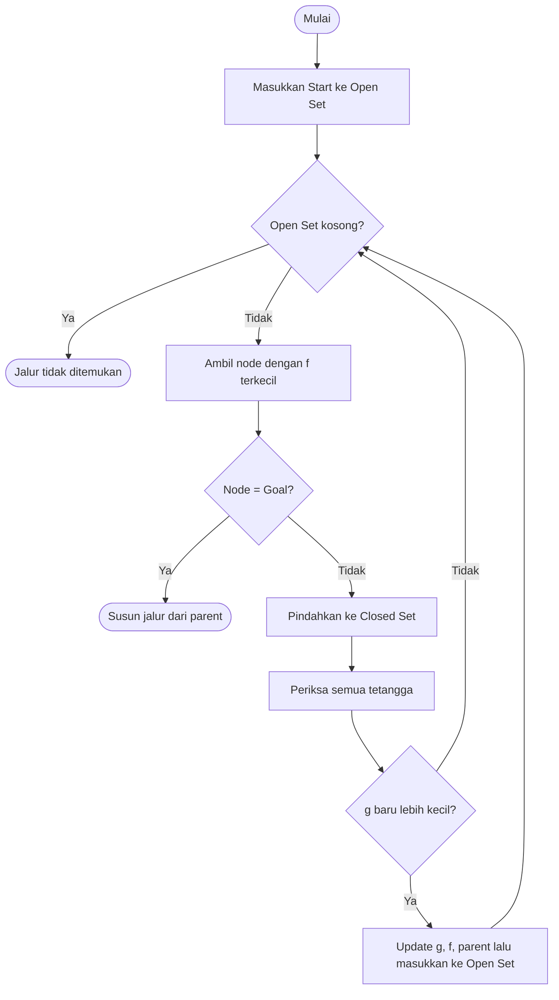
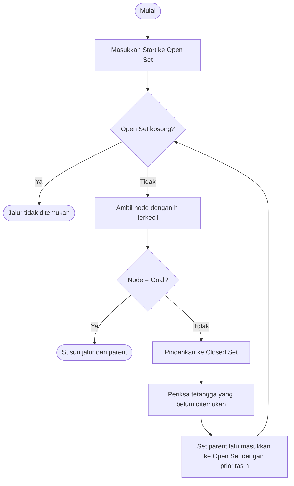
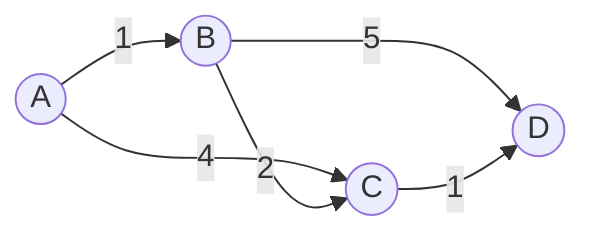

## 🧭 Informed Search Algorithm (Visualisasi A\* dan Greedy Best-First Search)

> Bagian ini membahas visualisasi **Informed Search**, yaitu algoritma pencarian yang memakai *informasi tambahan* (heuristik) untuk memilih jalur.
---

## 📑 Daftar Isi
1. [Pengertian](#1-pengertian)
2. [Konsep Dasar](#2-konsep-dasar)
3. [Algoritma yang Dibahas](#3-algoritma-yang-dibahas)
4. [Cara Kerja A\*](#4-cara-kerja-a)
5. [Cara Kerja Greedy Best-First Search](#5-cara-kerja-greedy-best-first-search)
6. [Perbedaan A\* dan Greedy](#6-perbedaan-a-dan-greedy)
7. [Contoh Perhitungan Manual](#7-contoh-perhitungan-manual)
8. [Visualisasi Algoritma](#8-visualisasi-algoritma)
9. [Efisiensi (Kompleksitas)](#9-efisiensi-kompleksitas)
10. [Kelebihan dan Kekurangan](#10-kelebihan-dan-kekurangan)
11. [Perbandingan Seluruh Algoritma](#11-perbandingan-seluruh-algoritma)
12. [Penerapan di Dunia Nyata](#12-penerapan-di-dunia-nyata)
13. [Kesimpulan](#13-kesimpulan)

---

## 1. Pengertian

**Informed Search** (*heuristic search*) adalah algoritma pencarian yang menggunakan **pengetahuan tambahan tentang masalah** untuk memperkirakan seberapa dekat suatu node dengan tujuan. Pengetahuan ini disebut **fungsi heuristik** `h(n)`.

Berbeda dengan BFS dan DFS yang mencari secara "buta" (hanya tahu struktur graf), Informed Search bisa **memprioritaskan node yang tampak lebih menjanjikan**. Akibatnya, jumlah node yang perlu dikunjungi biasanya jauh lebih sedikit.

| | Uninformed (BFS, DFS) | Informed (A\*, Greedy) |
|---|---|---|
| Informasi yang dipakai | Hanya struktur graf | Struktur graf + heuristik `h(n)` |
| Arah pencarian | Melebar / mendalam tanpa tahu tujuan | Terarah ke tujuan |
| Jumlah node dieksplorasi | Banyak | Umumnya lebih sedikit |

> 💡 **A\* dan Greedy Best-First sama-sama Informed Search.** Keduanya memakai heuristik `h(n)`. Perbedaannya hanya pada **rumus prioritas** yang dipakai untuk memilih node berikutnya:
> - **Greedy**: `f(n) = h(n)` (hanya melihat perkiraan jarak ke Goal),
> - **A\***: `f(n) = g(n) + h(n)` (melihat biaya yang sudah ditempuh **dan** perkiraan sisa jarak).
>
> Karena rumusnya mirip, keduanya cocok dibandingkan langsung pada visualisasi.

---

## 2. Konsep Dasar

### Istilah penting

| Istilah | Arti |
|---|---|
| **Node** | Titik / kotak pada graf atau grid |
| **Edge / Cost** | Biaya berpindah dari satu node ke node lain |
| **Start** | Node awal |
| **Goal** | Node tujuan |
| **Open Set** (*frontier*) | Node yang sudah ditemukan tetapi belum dieksplorasi |
| **Closed Set** (*explored*) | Node yang sudah selesai dieksplorasi |
| **Priority Queue** | Antrian yang selalu mengeluarkan node dengan nilai terkecil lebih dulu |

### Tiga nilai utama

```
f(n) = g(n) + h(n)
```

- **`g(n)`**: biaya *sebenarnya* dari **Start** ke node `n`.
- **`h(n)`**: biaya *perkiraan* dari node `n` ke **Goal** (heuristik).
- **`f(n)`**: nilai prioritas. Node dengan `f` terkecil dipilih lebih dulu.

| Algoritma | Nilai `f(n)` yang dipakai |
|---|---|
| **A\*** | `g(n) + h(n)` |
| **Greedy Best-First** | `h(n)` saja (mengabaikan `g`) |

### Jenis heuristik pada grid

| Heuristik | Rumus | Cocok untuk |
|---|---|---|
| **Manhattan** | `\|x1 - x2\| + \|y1 - y2\|` | Grid, gerakan 4 arah (atas, bawah, kiri, kanan) |
| **Euclidean** | `√((x1 - x2)² + (y1 - y2)²)` | Gerakan bebas ke segala arah |
| **Chebyshev** | `max(\|x1 - x2\|, \|y1 - y2\|)` | Grid, gerakan 8 arah (termasuk diagonal) |

### Syarat heuristik agar A\* optimal

- **Admissible**: heuristik *tidak pernah melebihi* biaya sebenarnya (`h(n) ≤ h*(n)`).
- **Consistent** (monotonic): `h(n) ≤ c(n, n') + h(n')`. Syarat ini lebih kuat, dan membuat node yang sudah di-*closed* tidak perlu dibuka ulang.

> Greedy tidak membutuhkan syarat ini untuk **berjalan**, tetapi syarat ini **tidak cukup** membuat Greedy optimal, karena Greedy tidak memperhitungkan `g(n)`.

---

## 3. Algoritma yang Dibahas

| Algoritma | Rumus prioritas | Memakai heuristik? | Menjamin jalur terpendek? |
|---|---|:---:|:---:|
| **Greedy Best-First Search** | `h(n)` | ✅ | ❌ |
| **A\* (A-Star)** | `g(n) + h(n)` | ✅ | ✅ (jika heuristik admissible) |

---

## 4. Cara Kerja A\*

A\* menggabungkan dua hal: **biaya yang sudah ditempuh** (`g`) agar jalurnya tetap murah, dan **perkiraan jarak ke tujuan** (`h`) agar pencarian terarah.

### Langkah-langkah

1. Masukkan node **Start** ke **Open Set** dengan `g = 0`, `f = h(start)`.
2. **Ulangi** selama Open Set tidak kosong:
   1. Ambil node dengan **`f` terkecil** dari Open Set (sebut `current`).
   2. Jika `current` adalah **Goal**, selesai. Susun jalur dengan menelusuri *parent* dari Goal sampai Start.
   3. Pindahkan `current` ke **Closed Set**.
   4. Untuk setiap **tetangga** dari `current`:
      - Lewati jika tetangga adalah dinding atau sudah ada di Closed Set.
      - Hitung `g_baru = g(current) + cost(current, tetangga)`.
      - Jika tetangga belum ada di Open Set **atau** `g_baru` lebih kecil dari `g` sebelumnya:
        - perbarui `g`, `f = g + h`, dan `parent = current`,
        - masukkan tetangga ke Open Set.
3. Jika Open Set habis dan Goal belum tercapai, **jalur tidak ada**.

### Flowchart



### Pseudocode

```text
function A_STAR(start, goal):
    open_set  ← priority queue berisi (f = h(start), start)
    g[start]  ← 0
    parent    ← {}
    closed    ← {}

    while open_set tidak kosong:
        current ← pop node dengan f terkecil
        if current == goal:
            return rekonstruksi_jalur(parent, current)

        closed.add(current)
        for neighbor in tetangga(current):
            if neighbor in closed: continue
            g_baru ← g[current] + cost(current, neighbor)
            if g_baru < g.get(neighbor, ∞):
                parent[neighbor] ← current
                g[neighbor]     ← g_baru
                f ← g_baru + h(neighbor)
                push (f, neighbor) ke open_set

    return "tidak ada jalur"
```

---

## 5. Cara Kerja Greedy Best-First Search

Greedy hanya melihat **heuristik**: `f(n) = h(n)`. Node yang *tampak* paling dekat dengan Goal selalu dipilih lebih dulu, **tanpa memedulikan biaya yang sudah ditempuh**. Ibaratnya berjalan lurus ke arah tujuan tanpa menghitung seberapa jauh sudah berjalan.

### Langkah-langkah

1. Masukkan node **Start** ke **Open Set** dengan prioritas `h(start)`.
2. **Ulangi** selama Open Set tidak kosong:
   1. Ambil node dengan **`h` terkecil** (sebut `current`).
   2. Jika `current` adalah **Goal**, selesai. Susun jalur dengan menelusuri *parent*.
   3. Pindahkan `current` ke **Closed Set**.
   4. Untuk setiap **tetangga** yang bukan dinding dan belum pernah ditemukan:
      - catat `parent = current`,
      - masukkan ke Open Set dengan prioritas `h(tetangga)`.
3. Jika Open Set habis dan Goal belum tercapai, **jalur tidak ada**.

> Perhatikan: pada Greedy **tidak ada perhitungan `g`** dan **tidak ada pembaruan jalur yang lebih murah**. Begitu sebuah node ditemukan, parent-nya tidak diperbaiki lagi. Inilah sumber utama ketidakoptimalannya.

### Flowchart



### Pseudocode

```text
function GREEDY_BEST_FIRST(start, goal):
    open_set   ← priority queue berisi (h(start), start)
    discovered ← {start}
    parent     ← {}
    closed     ← {}

    while open_set tidak kosong:
        current ← pop node dengan h terkecil
        if current == goal:
            return rekonstruksi_jalur(parent, current)

        closed.add(current)
        for neighbor in tetangga(current):
            if neighbor in discovered: continue
            discovered.add(neighbor)
            parent[neighbor] ← current
            push (h(neighbor), neighbor) ke open_set

    return "tidak ada jalur"
```

---

## 6. Perbedaan A\* dan Greedy

| Aspek | Greedy Best-First | A\* |
|---|---|---|
| Rumus prioritas | `h(n)` | `g(n) + h(n)` |
| Yang dipertimbangkan | Hanya perkiraan sisa jarak | Biaya tempuh + perkiraan sisa jarak |
| Perbaiki jalur yang lebih murah? | ❌ Tidak | ✅ Ya (jika `g_baru` lebih kecil) |
| Jalur terpendek | ❌ Tidak dijamin | ✅ Dijamin (heuristik admissible) |
| Kecepatan | Sangat cepat | Cepat, sedikit lebih lambat dari Greedy |
| Perilaku saat ada rintangan | Mudah terjebak | Mampu memutar dan mencari jalur lebih murah |

**Intinya:** Greedy *"berani tapi ceroboh"*, A\* *"terarah tapi tetap berhitung"*.

---

## 7. Contoh Perhitungan Manual

Graf berbobot dengan Start = **A** dan Goal = **D**:



Nilai heuristik (admissible dan consistent):

| Node | A | B | C | D |
|---|:---:|:---:|:---:|:---:|
| `h(n)` | 3 | 3 | 1 | 0 |

### A\*

| Langkah | Node diambil | Tetangga yang diperbarui | Open Set (node : f) |
|:---:|:---:|---|---|
| 1 | **A** (f=3) | B: g=1, f=4 · C: g=4, f=5 | B:4, C:5 |
| 2 | **B** (f=4) | C: g=3 (lebih kecil dari 4), f=4 · D: g=6, f=6 | C:4, D:6 |
| 3 | **C** (f=4) | D: g=4 (lebih kecil dari 6), f=4 | D:4 |
| 4 | **D** (Goal ✅) | - | - |

**Jalur: A → B → C → D, total biaya = 4** ✅ (optimal)

### Greedy Best-First (`f = h`)

| Langkah | Node diambil | Keterangan |
|:---:|:---:|---|
| 1 | **A** | Tetangga: B (h=3), C (h=1) |
| 2 | **C** (h=1, terkecil) | Tetangga: D (h=0) |
| 3 | **D** (Goal ✅) | - |

**Jalur: A → C → D, total biaya = 5** ❌ (bukan yang terpendek)

> Greedy langsung memilih C karena tampak lebih dekat ke Goal, tetapi lupa bahwa jalur A→C mahal (biaya 4). A\* memperhitungkan `g` sehingga menemukan jalur yang lebih murah.

### Ringkasan hasil

| Algoritma | Node yang diproses | Jalur | Biaya |
|---|:---:|---|:---:|
| **A\*** | A, B, C, D (4 node) | A → B → C → D | **4** ✅ |
| **Greedy** | A, C, D (3 node) | A → C → D | 5 ❌ |

Greedy memproses lebih sedikit node, tetapi hasilnya lebih mahal. Inilah **trade-off kecepatan vs kualitas**.

---

## 8. Visualisasi Algoritma

Pada grid, setiap sel digambarkan sebagai node. Visualisasi membantu kita **melihat langsung perbedaan perilaku** tiap algoritma.

### Legenda warna

| Warna | Arti |
|:---:|---|
| 🟩 Hijau | **Start** |
| 🟥 Merah | **Goal** |
| ⬛ Hitam | **Dinding / rintangan** |
| 🟦 Biru muda | **Open Set** (frontier: sudah ditemukan, belum diproses) |
| 🟪 Ungu / biru tua | **Closed Set** (sudah dieksplorasi) |
| 🟨 Kuning | **Jalur akhir** (hasil pencarian) |

> Sesuaikan tabel ini dengan warna yang benar-benar dipakai pada program kalian.

### Contoh ilustrasi sederhana (teks)

`S` = Start, `G` = Goal, `#` = dinding, `*` = jalur akhir, `o` = node yang dieksplorasi

Dinding berbentuk **"U"** dengan bukaan menghadap Start, dan Goal berada di belakang dinding:

```text
Greedy (masuk ke dalam "U", lalu terjebak)   A* (cepat menyadari jebakan)
. . . . . . . . . .                          * * * * * * * * * *
. . . # # # # # . .                          * . . # # # # # . *
. . . o o o o # . .                          * . . . . . . # . *
S o o o o o o # . G                          S o o . . . . # . G
. . . o o o o # . .                          . . . . . . . # . .
. . . # # # # # . .                          . . . # # # # # . .
. . . . . . . . . .                         . . . . . . . . . .

Greedy mengisi seluruh bagian dalam "U"      A* hanya sedikit masuk, lalu memutar
sebelum akhirnya memutar. Node banyak,       dan memperoleh jalur terpendek.
jalur akhir panjang dan berbelit.
```

> Ilustrasi di atas bersifat konseptual. Pola sebenarnya bergantung pada heuristik dan urutan tetangga yang dipakai.

### Yang perlu diamati saat visualisasi

| Algoritma | Pola eksplorasi | Hasil jalur |
|---|---|---|
| **Greedy** | **Langsung lurus** ke Goal, bisa tersangkut dinding | Belum tentu terpendek ❌ |
| **A\*** | Menyempit dan **condong ke arah Goal**, tetapi tetap melebar bila perlu | Terpendek ✅ |

### Cara membaca visualisasi

1. **Pelebaran area biru/ungu** menunjukkan seberapa banyak node yang harus diperiksa. Semakin sedikit, semakin efisien.
2. **Bentuk frontier**: Greedy membentuk "garis lurus" ke Goal, sedangkan A\* membentuk "panah" yang bisa melebar saat ada rintangan.
3. **Jalur kuning** muncul hanya setelah Goal ditemukan, dengan menelusuri *parent* dari Goal ke Start.
4. Coba **tambahkan dinding berbentuk "U"** di depan Goal. Greedy akan masuk ke dalam "U", terjebak, dan memutar jauh, sedangkan A\* tetap menemukan jalur terpendek.
5. Bandingkan **panjang jalur kuning** dan **jumlah sel ungu** dari kedua algoritma pada peta yang sama.

### Contoh kode inti (Python)

**A\***

```python
import heapq

def heuristic(a, b):
    # Manhattan distance
    return abs(a[0] - b[0]) + abs(a[1] - b[1])

def a_star(grid, start, goal):
    rows, cols = len(grid), len(grid[0])
    open_set = [(heuristic(start, goal), 0, start)]   # (f, g, node)
    parent = {}
    g_score = {start: 0}
    closed = set()
    visited_order = []                                # urutan node untuk animasi

    while open_set:
        f, g, current = heapq.heappop(open_set)
        if current in closed:
            continue
        closed.add(current)
        visited_order.append(current)

        if current == goal:
            path = [current]
            while current in parent:
                current = parent[current]
                path.append(current)
            return path[::-1], visited_order

        r, c = current
        for dr, dc in [(1, 0), (-1, 0), (0, 1), (0, -1)]:
            nr, nc = r + dr, c + dc
            if 0 <= nr < rows and 0 <= nc < cols and grid[nr][nc] == 0:
                neighbor = (nr, nc)
                new_g = g + 1
                if new_g < g_score.get(neighbor, float("inf")):
                    g_score[neighbor] = new_g
                    parent[neighbor] = current
                    f_new = new_g + heuristic(neighbor, goal)
                    heapq.heappush(open_set, (f_new, new_g, neighbor))

    return None, visited_order
```

**Greedy Best-First Search**

```python
def greedy_best_first(grid, start, goal):
    rows, cols = len(grid), len(grid[0])
    open_set = [(heuristic(start, goal), start)]      # (h, node)
    parent = {}
    discovered = {start}
    closed = set()
    visited_order = []

    while open_set:
        h, current = heapq.heappop(open_set)
        if current in closed:
            continue
        closed.add(current)
        visited_order.append(current)

        if current == goal:
            path = [current]
            while current in parent:
                current = parent[current]
                path.append(current)
            return path[::-1], visited_order

        r, c = current
        for dr, dc in [(1, 0), (-1, 0), (0, 1), (0, -1)]:
            nr, nc = r + dr, c + dc
            if 0 <= nr < rows and 0 <= nc < cols and grid[nr][nc] == 0:
                neighbor = (nr, nc)
                if neighbor not in discovered:
                    discovered.add(neighbor)
                    parent[neighbor] = current
                    heapq.heappush(open_set, (heuristic(neighbor, goal), neighbor))

    return None, visited_order
```

**Perbedaan intinya hanya pada prioritas:**

```python
# A*     → f(n) = g(n) + h(n)
f_new = new_g + heuristic(neighbor, goal)

# Greedy → f(n) = h(n)
f_new = heuristic(neighbor, goal)
```

> Simpan `visited_order` dan `path` untuk dipakai oleh bagian animasi (misalnya `pygame`, `matplotlib`, atau `tkinter`), sehingga setiap langkah bisa digambar satu per satu.

> 📎 Implementasi lengkap beserta visualisasinya ada di [`main.py`](./main.py).

---

## 9. Efisiensi (Kompleksitas)

Notasi: `b` = branching factor, `d` = kedalaman solusi, `m` = kedalaman maksimum.

| Algoritma | Waktu | Memori | Lengkap (*complete*)? | Optimal? |
|---|---|---|:---:|:---:|
| **A\*** | `O(bᵈ)` kasus terburuk, jauh lebih cepat dengan heuristik bagus | `O(bᵈ)` | ✅ | ✅ (heuristik admissible) |
| **Greedy Best-First** | `O(bᵐ)` kasus terburuk | `O(bᵐ)` | ❌ (bisa berputar tanpa *closed set*) | ❌ |

### Poin efisiensi

- **Kualitas heuristik menentukan kecepatan keduanya**. Semakin dekat `h(n)` dengan biaya sebenarnya, semakin sedikit node yang dieksplorasi.
- Jika `h(n) = 0`, A\* kehilangan arah dan eksplorasinya menyebar ke segala arah (paling banyak eksplorasi).
- Jika `h(n)` *melebihi* biaya sebenarnya (non-admissible), A\* menjadi lebih cepat tetapi **kehilangan jaminan optimal**. Semakin besar `h` mendominasi, perilakunya semakin mirip Greedy.
- **Memori** adalah kendala utama A\*, karena semua node di Open dan Closed Set harus disimpan. Greedy biasanya lebih hemat pada kasus sederhana.
- Penggunaan **priority queue (heap)** sangat penting. Memakai list biasa akan memperlambat pencarian secara signifikan.

---

## 10. Kelebihan dan Kekurangan

### ✅ A\*

| Kelebihan | Kekurangan |
|---|---|
| Menjamin jalur **terpendek** (jika heuristik admissible) | Butuh **memori besar** (menyimpan semua node terbuka) |
| **Terarah**, sehingga efisien dibanding pencarian buta | Kualitas hasil dan kecepatan **bergantung pada heuristik** |
| **Complete**: pasti menemukan solusi jika ada | Perlu merancang heuristik yang sesuai dengan masalah |
| Bisa memperbaiki jalur bila ditemukan rute yang lebih murah | Lebih lambat dari Greedy pada kasus sederhana |

### ✅ Greedy Best-First Search

| Kelebihan | Kekurangan |
|---|---|
| Sangat **cepat** pada banyak kasus | **Tidak menjamin** jalur terpendek |
| Eksplorasi node **sedikit** | Mudah **terjebak** pada rintangan (local optimum) |
| Implementasi sederhana | Bisa tidak lengkap jika tidak memakai *closed set* |
| Hemat memori pada peta sederhana | Mengabaikan biaya yang sudah ditempuh (`g`) |

---

## 11. Perbandingan Seluruh Algoritma

Gabungan dengan bagian **Uninformed Search** sebelumnya:

| Aspek | BFS | DFS | Greedy | A\* |
|---|:---:|:---:|:---:|:---:|
| Kategori | Uninformed | Uninformed | Informed | Informed |
| Struktur data | Queue | Stack | Priority Queue | Priority Queue |
| Graf berbobot | ❌ | ❌ | ✅ | ✅ |
| Memakai heuristik | ❌ | ❌ | ✅ | ✅ |
| Jalur terpendek | ✅ (tanpa bobot) | ❌ | ❌ | ✅ |
| Kecepatan | Sedang | Bervariasi | Cepat | Cepat |
| Memori | Tinggi | Rendah | Sedang | Tinggi |

---

## 12. Penerapan di Dunia Nyata

- 🎮 **Game**: pathfinding NPC / karakter (RTS, RPG, dll.). A\* untuk jalur akurat, Greedy bila butuh respons sangat cepat.
- 🗺️ **Navigasi peta**: Google Maps, GPS, dan rute pengiriman
- 🤖 **Robotika**: perencanaan gerak robot dan kendaraan otonom
- 🧩 **Puzzle**: 8-puzzle, Rubik's cube, dan penyelesaian maze
- 📦 **Logistik**: optimasi rute gudang dan pengiriman
- 🔎 **Pencarian cepat "cukup baik"**: Greedy dipakai saat solusi *good enough* lebih penting daripada solusi optimal

---

## 13. Kesimpulan

1. **Informed Search** memanfaatkan heuristik untuk mengarahkan pencarian sehingga lebih efisien daripada pencarian buta.
2. **A\*** adalah algoritma paling seimbang karena **optimal dan efisien**, dengan syarat heuristiknya admissible.
3. **Greedy Best-First** sangat cepat dan sederhana, tetapi **tidak menjamin hasil terbaik** karena mengabaikan biaya yang sudah ditempuh.
4. Perbedaan keduanya hanya pada rumus prioritas: **A\* = `g + h`**, **Greedy = `h`**.
5. **Visualisasi** memperlihatkan perbedaan nyata: Greedy lurus menuju Goal namun mudah tersangkut, sedangkan A\* terarah dan tetap menemukan jalur terpendek.

---

## 📚 Referensi

- Russell, S. & Norvig, P. *Artificial Intelligence: A Modern Approach* (Bab Informed Search).
- Hart, P., Nilsson, N., & Raphael, B. (1968). *A Formal Basis for the Heuristic Determination of Minimum Cost Paths*.
- Red Blob Games: *Introduction to the A\* Algorithm* (https://www.redblobgames.com/pathfinding/a-star/introduction.html)
